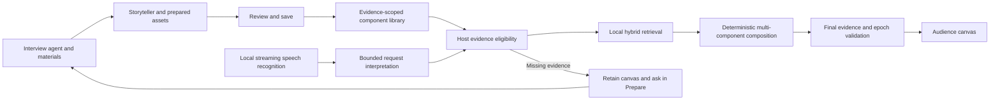

# Omnipresent

A local-first presentation canvas that prepares a story with you and composes supported visuals as you speak.

**Early research prototype.** Prepare and Canvas are working development surfaces, but spontaneous-speech acceptance is not solved. The latest real audio test held a supported explanation because STT split it and the bounded interpreter rejected the fragments. We publish failures alongside successes; see [results](docs/research/preference-quality.md) and the [validation register](docs/validation/test-register.md).

## How it works



“Host” means Omnipresent's application code. Models cannot approve evidence, bypass eligibility, or commit a stale result. A story is a narrative prior and preparation view, not a fixed slide sequence.

## Current defaults

| Role | Default |
| --- | --- |
| Interview and storytelling | Local OpenAI-compatible endpoint; `qwen3.5:4b` via Ollama |
| Speech recognition | Local Moonshine Small Streaming, English |
| Retrieval | BM25 plus pinned EmbeddingGemma 2 text embeddings, reciprocal-rank fusion and exact vector caching |
| Live asset selection | Host eligibility plus local hybrid ranking; no billed decision model |
| Composition | Validated deterministic synthesis, up to four supported components |
| Preference models | GLiNER and MiniLM are opt-in experiments; neither passed the promotion gate |

Defaults live in [runtime configuration](server/config/defaults.ts), [retrieval model pin](runtime/retrieval-model.json) and the [speech worker](runtime/worker.py). Hosted comparison profiles require explicit selection and your own `OPENROUTER_API_KEY`. There is no automatic paid fallback or credential discovery in another application's files.

## Development setup

Requirements: Node.js **22.12+**, npm, [uv](https://docs.astral.sh/uv/), Python **3.12** managed by uv, and a local model server for preparation. Development has been exercised on macOS/Apple Silicon; CI checks portable software behavior on Linux. Other platforms' model runtimes remain unverified.

```sh
git clone https://github.com/gksoriginals/omnipresent.git
cd omnipresent
npm ci
cp .env.example .env
```

For local preparation, install [Ollama](https://ollama.com/), start its service and download the configured model:

```sh
ollama pull qwen3.5:4b
```

Install speech and retrieval runtimes separately; these download packages and model weights and require additional disk/RAM:

```sh
npm run setup:speech
npm run retrieval:setup
npm run dev
```

Open **http://127.0.0.1:5173**. The coordinator listens on loopback port 4317 and the embedding service on 4332. `npm run dev` starts retrieval when installed; model initialization may take time. The speech model loads when presentation starts. Some Hugging Face models may require accepting upstream terms and local authentication; do not put tokens in source control. Read [third-party and model notices](THIRD_PARTY_NOTICES.md) before downloading or redistributing runtimes.

The UI can start without model environments; preparation, retrieval and voice features need their respective running dependencies. There is no fake-model success fallback. Use Prepare to chat and attach materials, finish the interview, review the generated story, and save it. Canvas lists saved stories; select one and start. Projects and stories persist in this browser; uploaded material files are stored under ignored `output/materials/`. This is a single-user local app, not a hosted multi-user service.

## Validate without models

```sh
npm test
npm run build
npm run validate:evidence
```

These checks do not require API keys, GPU, model downloads or paid inference. Model/audio benchmarks are separate, explicit commands; [testing guidance](docs/testing.md) explains their prerequisites, budgets and scope. A passing software suite does not turn a failed audio acceptance case into a pass.

## Contribute and follow the work

Start with [CONTRIBUTING](CONTRIBUTING.md), [architecture](docs/architecture/current.md), [roadmap](ROADMAP.md), [product requirements](docs/PRD.md), and [known limitations](docs/research/preference-quality.md). The [documentation index](docs/README.md) distinguishes current guidance from historical experiments.

Report reproducible bugs and propose experiments through GitHub issues. Report vulnerabilities privately through [SECURITY](SECURITY.md). Community participation follows our [code of conduct](CODE_OF_CONDUCT.md). There is no stable public API or compatibility guarantee yet.

No model weights, Python environments, credentials, personal presentation uploads or build outputs are distributed in this repository. Committed validation fixtures include authored synthetic stories, public-source evidence excerpts and synthetic Piper speech; see [third-party notices](THIRD_PARTY_NOTICES.md).
