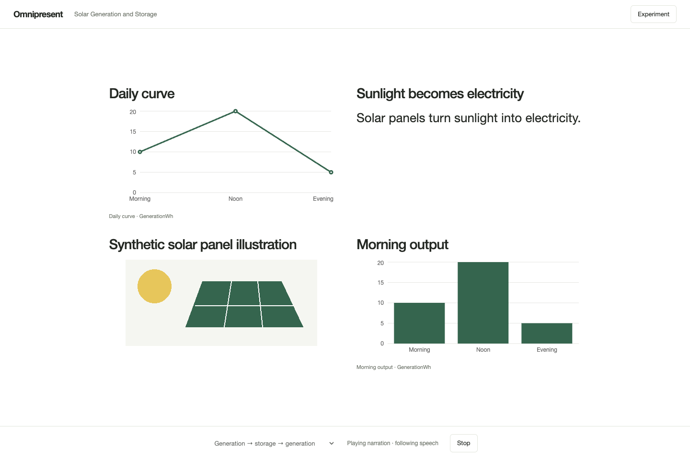
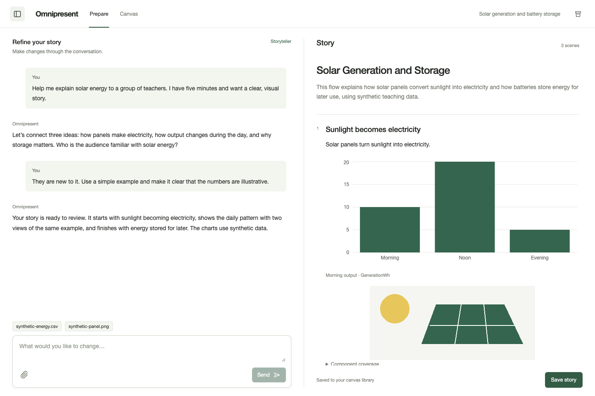

<p align="center">
  
</p>
<h1 align="center">Omnipresent</h1>
<p align="center"><strong>Prepare your story. Let the canvas follow your explanation.</strong></p>
<p align="center">
  <a href="LICENSE"></a>
  <a href="https://github.com/gksoriginals/omnipresent/actions/workflows/ci.yml"></a>
  <a href="docs/roadmap.md"></a>
</p>
<p align="center">
  <a href="#demo">Demo</a> ·
  <a href="#get-started">Get started</a> ·
  <a href="docs/README.md">Documentation</a> ·
  <a href=".github/CONTRIBUTING.md">Contributing</a>
</p>

Omnipresent helps you turn an idea and your materials into a visual presentation. Talk through your audience and goals, refine the story with an agent, then present on a canvas that brings up relevant text, charts, diagrams and images as you speak.

## Demo



*A real capture from the local spoken replay, using a synthetic solar-energy teaching example.*

<details>
<summary>See the preparation workspace</summary>

Chat and review the story side by side. Attach materials and ask for changes in the same conversation.



The conversation shown is an authored demonstration. [Screenshot details](docs/images/README.md).

</details>

## How it works

1. **Talk it through.** Describe your topic, audience and goal. Add notes, documents, images or spreadsheets.
2. **Shape the story.** Review the suggested flow beside your chat, ask for changes, and save it.
3. **Present.** Choose your story in Canvas and start. Omnipresent composes the prepared visuals around your explanation and asks for more context when something is unsupported.

## Features

| | |
| --- | --- |
| **Conversational preparation** | Separate interview and storytelling roles help gather context and shape the presentation. |
| **Your materials** | Upload documents, images and data; prepare charts and diagrams for the story. |
| **Adaptive canvas** | Combine relevant text and visuals for the current explanation. |
| **Multiple projects** | Keep separate preparation chats and saved stories. |
| **Local-first runtime** | Local speech recognition and presentation selection; no paid decision-model API required for the normal live path. |

**Early prototype.** Preparation and visual composition work, but spontaneous-speech understanding remains experimental. Some supported explanations are still rejected when speech is split or misrecognized. [Known limitations and test results](docs/research/preference-quality.md).

## Get started

Requires Node.js **22.13+**, npm, [uv](https://docs.astral.sh/uv/) and [Ollama](https://ollama.com/). Python 3.12 is used for local speech and retrieval. macOS/Apple Silicon is the exercised model-runtime platform; software CI also runs on Linux.

```sh
git clone https://github.com/gksoriginals/omnipresent.git
cd omnipresent
npm ci
npm run setup:env
ollama pull qwen3.5:4b
npm run setup:speech
npm run retrieval:setup
npm run dev
```

Start the Ollama service before preparing a story, then open **http://127.0.0.1:5173**. Runtime setup downloads packages and model weights.

[Full setup guide](docs/getting-started.md) · [Environment configuration](docs/configuration.md)

## Development

```sh
npm test
npm run build
npm run validate:evidence
```

Core checks need no model credentials or weight downloads. The optional extraction test needs its Python environment; CI installs it. Model, audio and browser experiments are separate.

[Architecture and model defaults](docs/architecture/current.md) · [Testing](docs/testing.md) · [Roadmap](docs/roadmap.md)

## Contributing

We are building in public. Reproducible bug reports, usability feedback and focused contributions are welcome. Start with the [contribution guide](.github/CONTRIBUTING.md) and [product requirements](docs/PRD.md).

[Support](.github/SUPPORT.md) · [Code of conduct](.github/CODE_OF_CONDUCT.md) · [Security reporting](.github/SECURITY.md) · [Governance](docs/governance.md)

## License

[Apache-2.0](LICENSE). Dependencies, models and research fixtures retain their [upstream terms](docs/third-party-notices.md). No model weights, credentials or personal presentation uploads are distributed in this repository.
