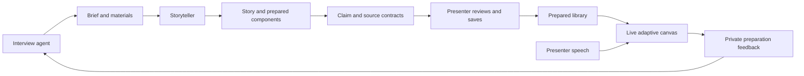
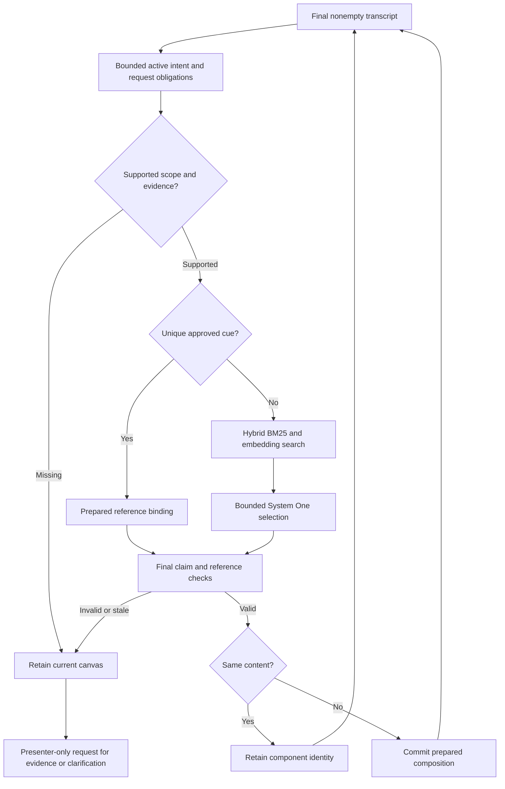
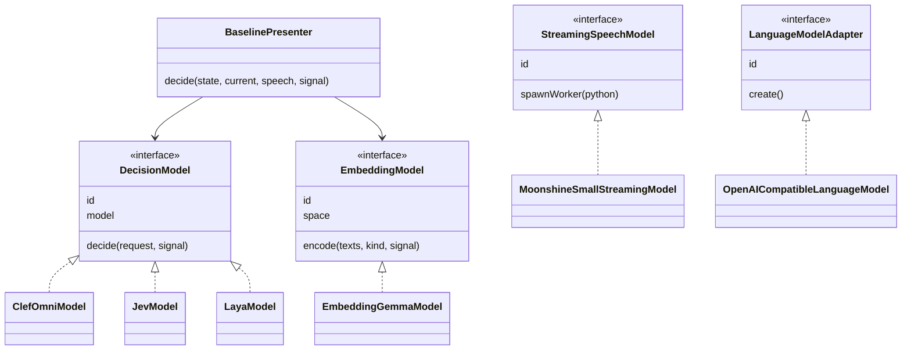
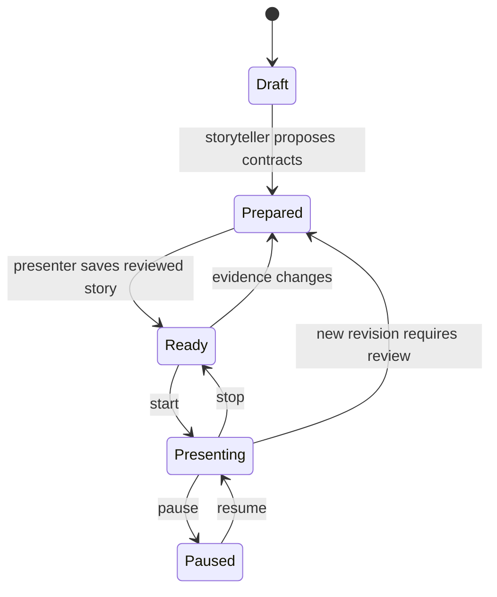

> Current public-development architecture: [implemented defaults and boundaries](current.md). This dated document is historical; hosted selection and earlier composition defaults below are superseded.

> Live selection update: [local-only selection and optional classifier preference](local-selection.md) defines current defaults, lifecycle, fallback and the closed feedback loop.

> 19 October 2026: [local-only selection baseline](local-selection.md) now supersedes the hosted ambiguous-decision default described below. Normal live presentation uses host eligibility and local hybrid ranking, with no provider model or automatic paid fallback. Historical evidence and explicit comparison adapters remain.

# Omnipresent baseline: evidence-first adaptive presentation

17 October 2026 · Development baseline selected by the user · Default live runtime.

The baseline prepares content once, retrieves approved components, interprets the presenter's intent and validates evidence before changing the canvas. Models propose selections; the host owns evidence, lifecycle, references and commit authority. A story is a preparation view and narrative prior, not a fixed deck advanced by voice commands.

The user authorized moving the system to this baseline, discarding incompatible stories and removing superseded code. This adoption is an implementation decision based on the development evidence, not a claim of independent production acceptance.

## Product flow

Interview and storyteller remain separate roles. New story proposals receive source identities, declared claim aliases, units and provenance. Save records presenter approval. Independent review stays pending unless separately performed; save does not establish audit status or independent claim verification. Unsupported evidence returns to preparation without replacing the current audience content.

## Live decision loop

The active `BaselinePresenter` uses the same evidence-gate family measured in EXP-037, with a story-local scope resolver: when one declared claim uniquely identifies its prepared context, it can supply omitted entity/provenance/form from that context. It never appends a claim inferred solely from a retrieved candidate. Explicit scope, audit requests, unknown facts and conflicting claims still constrain the final choice. This local resolver and live catalog integration are new integration behavior; the offline 37/37 result must not be relabeled a live benchmark result.

The interpreter is bounded and conservative. It recognizes prepared aliases and clear corrections, holds ambiguous quoted/hypothetical/negated speech and requests missing evidence for unknown obligations. General spontaneous-speech understanding is not established. Selection currently resolves one prepared component; compatible multi-component synthesis, intelligent reveal and semantic change-cost optimization remain follow-up work. Existing renderer layouts do not establish those policy capabilities.

## Host and model boundaries

`server/models` owns model interfaces, classes and transport. `server/presentation` owns preparation contracts, prepared-reference catalog and live pipeline. `server/controllers` owns retrieval, evidence checks and cancellation/retention policy. `AdaptiveController` owns bounded queued speech, pause/stop epochs and validated stage commits; it no longer constructs a general LLM presentation agent. The UI renders validated prepared references and never calls a model provider directly.

To add a decision model, implement `DecisionModel`, register an instance in `decisionRegistry`, and test transport/response behavior and pipeline invariants. The pipeline does not switch on provider names. OpenRouter-compatible models share a transport base class; local Laya implements the same interface with its local endpoint. Embedding and language providers have separate interfaces because their contracts differ. Do not force all model roles into one generic generate function.

## Selected defaults and retained experiments

| Role | Default | Extension/configuration |
| --- | --- | --- |
| Interview and storytelling | OpenAI-compatible local Qwen 3.5 4B | Existing `OMNIPRESENT_LLM_*` settings; `LanguageModelAdapter` |
| Streaming speech | Moonshine Small Streaming, local | `StreamingSpeechModel`; existing isolated Python worker |
| Embedding | Pinned text-only EmbeddingGemma 2, local | `EmbeddingModel`; model/revision/dimensions from runtime manifest |
| Candidate search | BM25 plus normalized cosine, RRF | Prepared snapshot and stable component references |
| Ambiguous eligible preference | Local hybrid ranking | `AssetSelector`; provider-backed comparisons require an explicit profile |
| Generative UI renderer | OpenUI bounded component renderer | JSON-render bounded renderer retained for comparison |
| Narration for experiments | Piper-generated prerecorded audio | Experiment capability, not a live product voice agent |

Useful executable decision adapters: Clef-omni, Clef-flash, Clef, Jev and local Laya. All retain the same host validation boundary. Microsoft Decision and Kev remain historical entries in documentation and model IDs, without executable registered adapters. Microsoft had provider blockers; Kev did not earn a role in the selected bounded pipeline. This does not mean Kev was never callable. Their blocked/negative results are not erased. Groq/other language models, alternate STT engines and smaller embedding configurations were researched rather than proven winners; do not imply they were all executed.

EmbeddingGemma is local text retrieval, not an evidence judge or image-understanding model. Image components use approved descriptions and references. No Clef weights are downloaded; hosted models use the existing credential source. The baseline needs the local embedding service and STT environment available; an unavailable service holds content and reports an error instead of silently falling back to an unguarded LLM.

## Review, revision and cancellation

The live snapshot is isolated from edits. Revisions invalidate cue bindings and embeddings; cancellation prevents old inference committing after pause, stop or a newer preparation. Current-content retention is explicit. Private requests go back to the originating preparation session, outside the audience canvas.

Local development uses presenter-approved contracts with independent-review status preserved as pending. Set `OMNIPRESENT_REQUIRE_INDEPENDENT_REVIEW=true` to require accepted independent review. No UI action self-certifies an audit. This setting does not substitute for the [real-library acceptance process](../research/real_library_acceptance.md).

## Removed paths and data

Removed the old slide/beat director, its obsolete local-model probe and associated runtime tests. Removed general-LLM canvas generation from the live adaptive controller, unguarded model bypass in the live protocol, unselected Microsoft/Kev registrations and old storage-key migration logic. Historical experiment reports, frozen source snapshots and failed results remain under validation/research.

Saved stories without approved evidence contracts are removed from the gallery/history/recoverable story list on read. Old story drafts are discarded while conversation/material sessions can be used to prepare a new story. No automatic conversion or evidence fabrication occurs. Old standalone legacy keys are no longer imported.

## Evidence and present limits

[EXP-037](../research/evidence_gate_results.md) establishes authored development quality and repeated text-decision timing. [The selected EIA/USGS starter](../research/source_backed_review.md) remains pending independent review and natural-speech acquisition. New live integration, model abstraction and UI checks are recorded separately. Passing software checks or a scripted websocket replay is not physical microphone, natural speech, real-media latency or production validation.

## Further experimentation

See the [modularization assessment](experimentation.md) for proposed retrieval, intent, selection, composition and benchmark boundaries. These are follow-up proposals; the interfaces described there are not yet implemented.

The first modularization slice now exposes `RetrievalFactory`/`RetrievalSnapshot` and `RequestInterpreter`/`RequestFrame`. Defaults retain the existing hybrid ranking and conservative story-local scope resolution. The original transcript remains the retrieval/model input; inferred scope is recorded separately for evidence evaluation. See the implementation checkpoint in the assessment for validation and remaining work.

## Compiled presentation optimization checkpoint

The [compiled snapshot, exact vector cache and readiness slice](compiled-presentations.md) is implemented. It preserves selection/fallback defaults, reuses one request frame, caches only immutable integrity/exact vectors, and prepares the index before speech starts. Paired local-embedding replay and readiness/cancellation evidence are recorded separately from historical model or audio acceptance.
