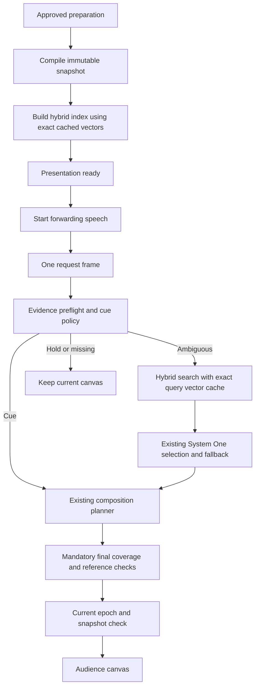

# Compiled presentation and exact embedding reuse

19 October 2026 · Implemented optimization slice; selection defaults unchanged.

The live path now prepares a host-owned snapshot and hybrid index before the browser begins forwarding presentation speech. An approved story still proposes content; all evidence, source identity, complete request coverage, revision and cancellation checks remain host responsibilities. Focus stays the default planner; the running rich demo uses the synthesis environment setting.

## Implemented boundaries

- `presentation/immutable.ts` clones and recursively freezes preparation data. Only objects registered by this host utility can take the identity-reuse path; a shallowly frozen caller object is not trusted.
- `presentation/prepared.ts` compiles a content-digested snapshot and catalog, memoized by the host-owned object. The digest includes actual content, reviewed revision and flow provenance, rather than trusting an incoming revision counter. Mutable direct API inputs are recompiled and validated. Catalog Maps/Sets remain internal host data; experimental planners receive structured clones, not mutable shared maps. This slice does not introduce a plugin registry or persistent compiled-story format.
- `CachedEmbedder` wraps the existing `Embedder` interface with a 256-entry exact vector LRU. Keys include serialized embedding-space configuration, exact text and document/query mode. The actual model manifest also includes prompts/configuration. Entries and returned vectors are isolated copies. Duplicate text within a batch is encoded once. Failed, malformed or cancelled work cannot populate the cache. Changed embedding identity fails closed and requires a new adapter instance. Independent concurrent calls are not deduplicated; cancelling one does not abort another.
- The cache belongs to a presenter instance, so projects/sessions do not share private inputs through a global cache. Revisions within that instance reuse unchanged document vectors. Reloading a story creates a new presenter and starts a fresh cache. Cross-load/disk persistence and request deduplication remain follow-up work, not implemented savings.
- `BaselinePresenter.prepare()` builds the catalog/index separately from `decide()`. The latter reuses one immutable request frame for preflight, final selected-evidence validation and composition planning. The policy accepts an optional per-call gate, preserving existing callers and avoiding a shared mutable request-frame closure.
- Immutable asset evidence integrity and approved component/source integrity checks are memoized by object identity. Mutable evidence is never memoized. Request-dependent coverage, selected reference checks, independent-review settings, planner isolation, final composition validation and latest-snapshot/turn checks still run. This is reuse of validated immutable integrity, not caching a semantic verdict for a different request.
- `AdaptiveController.start()` exposes an optional decider preparation promise. Incoming early speech waits for it; stop cancels preparation and queued speech cannot commit. Deciders without preparation preserve their existing immediate execution behavior. The server emits additive `presentation_ready` after successful preparation, echoing an optional start request ID. Current clients match the attempt ID so a previously queued acknowledgement cannot release a newer start. The browser microphone flow and replay wait for this signal before forwarding/playing speech. Readiness has a 60-second preparation deadline and stale ready/error callbacks are suppressed after stop/reload/disconnect.

Hybrid BM25/cosine/RRF, top-5 then top-12 grounding fallback, decision models, evidence thresholds and composition policy are unchanged. Index refresh still rebuilds lexical corpus statistics/rank fusion; only exact document vectors are reused. A cache hit never commits content by itself. No semantic answer cache or speculative decision commit was introduced.



## Measured evidence

[EXP-050 / final paired replay](../validation/runs/RUN-20261019-compiled-cache-v5/replay.json) compares the archived full-demo presenter against this implementation using the actual local EmbeddingGemma service. It uses the reviewed synthetic three-beat, seven-component story, 12 authored requests × three passes per arm, counterbalanced execution and two reviewed metadata refreshes per session. Selection uses an explicitly deterministic stub, not a hosted model. Exact actions, composition content and private questions matched in all 36 paired observations; neither arm errored. This is repeated development parity, not 36 independent quality observations.

| Metric | Prior | Optimized |
| --- | --- | --- |
| Decision median | 0.84 ms | 0.28 ms |
| Decision p95 | 100.26 ms | 27.18 ms |
| Session 1 including startup and all turns | 385.17 ms | 247.03 ms |
| Session 2 including startup and all turns | 369.74 ms | 149.55 ms |
| Session 3 including startup and all turns | 359.57 ms | 146.01 ms |
| Document encodes per session | 21 | 7 |
| Query encodes per session | 3 | 2 |
| Selection-stub calls per session | 3 | 3 |

Optimized initialization separately took 94–190 ms; the prior defers indexing into the first turn. Session totals include this work, so the comparison does not claim that moving startup work eliminated it. Scheduled metadata refresh, applicable retrieval and final validation are inside turn timing. v1/v2/v3/v4 are retained with their source/input hashes; gains appeared in each run. v2 ran alongside software validation and had uncontrolled resource contention. Small-sample p95 and local timing variance are not production SLO evidence.

[Actual WebSocket probe](../validation/runs/RUN-20261019-compiled-cache-v5/live.json) observed readiness after about 108 ms, a subsequent four-component cue decision in about 3.1 ms, and no ready event after a cancelled preparation. It uses text speech events, not microphone audio, STT or browser paint. The server was restarted with the optimized code and the existing synthesis demo setting. The final probe matches the start request ID and confirms the final runtime protocol.

Tests additionally cover changed reviewed content (only one changed document re-encoded), source withdrawal, unversioned mutation, lost approval, exact query/document mode separation, embedding-space changes, eviction, returned-vector mutation, malformed/cancelled results, independent concurrent cancellation, one interpretation per turn and stop during preparation. The first software audit exposed an injected-decider timing regression; it was fixed and the failed audit retained.

[Final software audit](../validation/runs/RUN-20261019-compiled-cache-release-v2-audit/run.json): 123 tests and production build pass. All experiment inputs, source snapshots and retained failures are registered by the validation catalog.

No hosted dollar reduction was measured: selection call count is unchanged. Reduced embedding work saves local compute, while future selection-policy experiments may reduce hosted calls. No large real-library, independent semantic quality, full audio-to-paint or concurrent-session capacity acceptance follows. Those remain required before promoting broader policy changes. The existing full spoken demonstration remains historical evidence; it was not rerun as audio in this optimization slice.

## Reproduce

```sh
node --import tsx scripts/optimization-replay.ts RUN-unique-optimization-id
# With the coordinator and embedding service running:
node --import tsx scripts/optimization-live-probe.ts output/unique-readiness-probe
npm test
npm run build
```

The replay refuses to overwrite a run folder, captures source/input hashes and records startup, every turn, refreshes, stage traces and model-stub/encoding counts. The live probe uses disposable socket sessions and the archived synthetic story; it does not alter saved projects. Next comparisons should target large-library cache refresh/queue pressure and natural fragmented speech before changing shortlist or scheduling policy.
