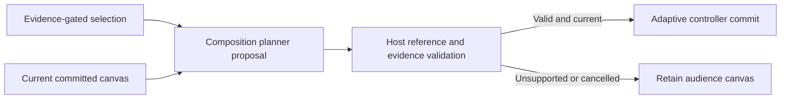

# Selection and composition boundaries

19 October 2026 · Implemented, default focus behavior retained.

Content selection now returns an asset identity. `presentationCatalog` records explicit beat/kind references instead of assigning layouts or parsing source positions back out of asset IDs. `CompositionPlanner` receives the selected reference, request frame, current committed composition and prepared catalog. It proposes a composition; a host-owned validator decides whether that proposal may proceed.

Two implementations are available:

- **focus** is the default. It reproduces the previous one-component focus layout, strong emphasis and full reveal.
- **stable** is opt-in. It retains the existing composition and reveal only when every block remains valid for the current request and the selected component is present. Otherwise it proposes focus. Set `OMNIPRESENT_COMPOSITION_PLANNER=stable` before starting the coordinator to try it. Unknown planner IDs fail rather than silently choosing another policy.

To add a planner, implement `CompositionPlanner`, register it in `compositionPlanner`, or inject it into `BaselinePresenter`. Planners receive a cloned context: changing their copy cannot rewrite the evidence or preparation used by final host validation. The guard checks selected-component inclusion, every displayed reference's claim/scope/form/provenance/review coverage, duplicate content and slot IDs, prepared visual references, and diagram reveal bounds. Cancellation is checked after planning and validation. Trace events identify planning and final composition-validation stages.

Before each decision, the library policy synchronizes its current asset with the actual current composition supplied by `AdaptiveController`. A proposal rejected after selection therefore cannot become the authority for the next keep/retention decision. This reduces an existing duplicated-state risk; it is not a full consolidation of session, policy and controller state.

## Evidence and limits

The [synthetic planner replay](../validation/runs/RUN-20261019-composition-planners-v1/replay.json) compares focus/stable using the shared runner: five scenarios, three passes per planner, 15/15 expected outcomes each. Assertions inspect actual layout/reveal as well as selection outcomes. Stable preserves an eligible reveal of two nodes; focus resets to full reveal. Wrong current content, duplicate content and an invalid reveal fall back to validated focus. The missing-evidence case is scripted, not an independently judged model decision. Refresh here rebuilds a small planner context, not a retrieval index.

Unit tests additionally verify rejection of unsupported additional content, omitted selections, invalid reveals, independent-review requirements, pre-cancelled work and attempts to mutate evidence through an injected planner. These are software invariants and authored fixtures, not general speech or independent semantic quality evidence. No new model calls, browser tests or performance winner claims are made for this slice. The frontend DOM/layout is unchanged.

New multi-component synthesis remains gated. Current catalog evidence is inherited from story beats; it does not establish independent visual claim coverage. The next step is component-level evidence contracts and compatibility rules, followed by composed-plan replay expectations. Merely placing two references together would not demonstrate intelligent or grounded composition.

Software verification: [97/97 tests and successful TypeScript/production build](../validation/runs/RUN-20261019-composition-planner-audit/run.json). Validation catalog and frozen replay hashes verified.

## Component-coverage follow-up

[Explicit component contracts and opt-in paired planning](component-coverage.md) now provide the first bounded two-component experiment. Focus remains the default. This supersedes the earlier implementation limit for newly declared/approved component coverage only; legacy beat-only contracts remain ineligible for pairing. Semantic verification, finer claims and broader synthesis are still pending.
