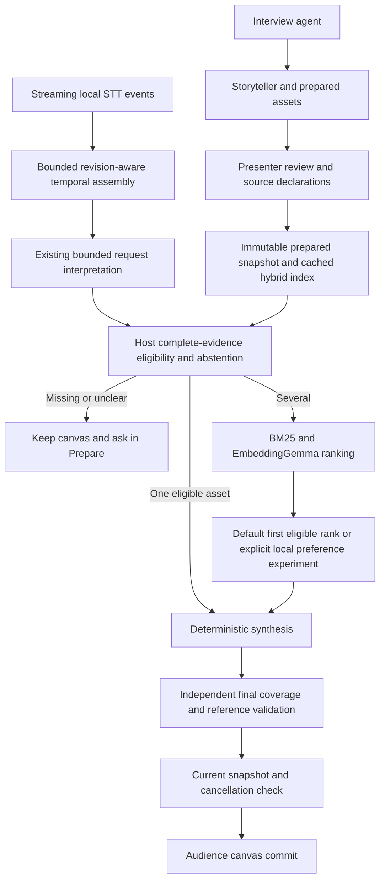
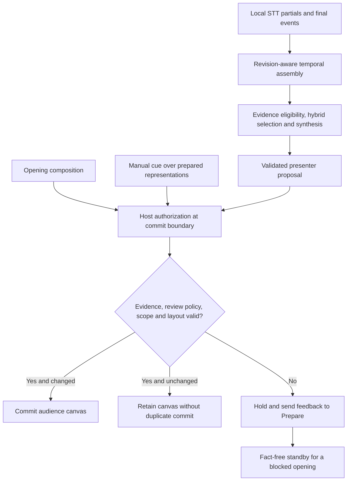
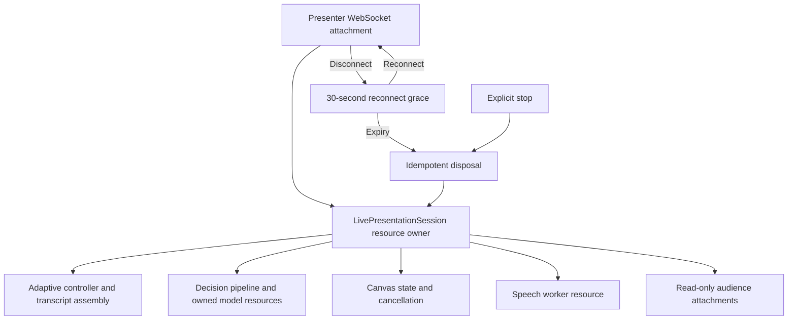

# Current architecture and defaults

19 October 2026. Implemented local development architecture; spontaneous-speech acceptance remains failed.

## Findings adopted in code

`server/config/defaults.ts` is the product composition root's default policy: local Qwen preparation, local hybrid live selection and deterministic synthesis. EmbeddingGemma is pinned in `runtime/retrieval-model.json`; Moonshine Small Streaming remains the local STT reference. These latter choices have not earned independent production acceptance merely because preference tests ran.

`createPresenter()` constructs no billed decision model for normal presentation. `baseline` remains an alias for local hybrid. The old helper that implicitly selected a hosted Clef model was removed; explicit hosted comparisons resolve a named registry entry. Credential transport now accepts only `OPENROUTER_API_KEY` and does not inspect another application's auth files.

The default composition root uses the already-tested synthesis planner (up to four supported components), with a focus fallback when independent component coverage is insufficient. `OMNIPRESENT_COMPOSITION_PLANNER` still explicitly selects a comparison planner. This adoption does not turn authored synthesis fixtures into natural-speech acceptance.

Live preference profiles are explicit: `local-classifier` loads the pinned native GLiNER reference, and `local-reranker` loads the pinned 22.7M MiniLM experiment. Both use the same eligible-menu abstraction, worker lifecycle, 300 ms deadline, local fallback and final host validation. Neither is the default: MiniLM matched hybrid accuracy; timed GLiNER fell back on every distinct-preference case; dynamic INT8 was worse. Experimental model environments and weights are not loaded in the normal presenter.

## Data and authority

Models propose references. Host code owns evidence eligibility, abstention, lifecycle, final validation and commit. A story is a narrative prior, not a voice-controlled slide deck. Unknown facts are never approved because a candidate is semantically close. Missing evidence is routed back to preparation with the story/project identity.

Preparation, voice, retrieval and preference are separate roles. The TypeScript coordinator, React canvas and isolated Python workers form a modular local application; no new service framework was introduced. Projects and stories are cached in browser storage and persisted in local SQLite. Startup hydration is guarded against concurrent edits, and tab-local writes are serialized/coalesced. Concurrent editing from multiple tabs is not supported. Uploaded artifacts live under ignored output directories, and model downloads remain outside tracked source.

Live presentation sessions own their controller and speech runtime independently of the presenter socket. Reconnection within 30 seconds preserves the canvas and reacquires microphone capture; an expired session starts afresh with normal indexing readiness. Explicit stop disposes the session. Audience sockets are read-only and receive a rendering projection plus canvas/status events, without interview messages, source text, private notes, transcripts or traces. This role boundary is for the local app, not a multi-user authentication system. Manual cues cancel older proposals and use host evidence eligibility, including strict independent-review mode.

Story bundles include referenced image bytes under their content hashes. Import validates media before workspace mutation, with an 8 MB per-image and 24 MB total media limit. Existing bundles without embedded media require those files to already exist locally. Full preparation context remains in the bundle; audience projection is applied only when presenting.

## Unresolved language boundary

The alpha real-audio experiment failed its supported panel explanation when Moonshine split it into two final segments. A subsequent temporal-assembly experiment recovered that authored case: 4/4 recordings passed versus 3/4 for per-final processing. Adding a separate compiled story-signal index gave the same results and was removed. The existing reviewed vocabulary and evidence interpreter remain authoritative; there is no new keyword filter or additional VAD. See [assembly ablation and limits](../research/speech-assembly.md). On 32 distinct natural preference utterances, the strict parser also produced no present intents. The role-only preference screen therefore used explicitly declared intents and reports that limitation.

Do not describe this architecture as solved speech understanding. Bounded completed-speech assembly is now implemented: partials remain display-only, source intervals and line revisions preserve complete text, and a 350 ms quiet window precedes host processing. It adds roughly 350–400 ms after the final event in the small development replay. Unknown obligations are not removed. Real microphones, delayed continuations and a local intent/purpose proposal layer still require evaluation against missing evidence, negation, corrections and stale work; general speech understanding remains unresolved.

See [latest experiments](../research/preference-quality.md), [local selection lifecycle](local-selection.md), [historical baseline](baseline.md), and [roadmap](../roadmap.md). The historical baseline's hosted defaults are superseded by this document.

## Common commit authority and resumable ownership

The opening, manual cues and automatic proposals now pass `server/presentation/authorization.ts` at the controller commit boundary. It reconstructs the request from host-owned story evidence or the full utterance and reuses the complete composition validator: evidence eligibility, independent review policy, explicit requested form, component coverage, layout and final grounding. A model cannot bypass this by returning a structurally valid composition. Inferred form remains a preference; spoken constraints remain binding. A blocked opening displays a fact-free “Ready to present” standby and sends feedback to Prepare. Invalid or stale later proposals preserve the canvas.

`server/presentation/live-session.ts` owns resumable resources and idempotent disposal: controller, canvas session, presenter, speech worker, audience attachments and reconnect expiry. Its lifecycle distinguishes loaded, preparing, ready and disposed. The WebSocket connection borrows these resources; replacing it cancels expiry, while final expiry or stop releases them once. Wire messages and saved story formats are unchanged. Speech transport and command routing still live in `server/index.ts`; frontend pause/microphone state is not yet unified into this lifecycle.

These are incremental implementations of stages 1 and 2 of the domain review. Stable component identities, narrower audience contracts and shared preparation commands remain separate work. The software audit verifies model-free authorization, cleanup, reconnect and privacy regressions; it does not establish a latency gain or general speech acceptance.

### Final authorization for every entry path

Partials remain display-only. The controller rejects cancelled or stale work before authorization. Presenter validation and the independent host commit check are separate boundaries; redundant checks within the controller were removed. Neither models nor renderer adapters can authorize evidence.

### Resumable presentation ownership

The owner tracks loaded, preparing, ready and disposed states. Socket replacement retains the existing resources and cancels expiry. Disposal cancels decisions, releases the presenter and speech worker, and notifies audiences. Transport callbacks and frontend microphone/pause coordination remain outside this ownership extraction.

Latest cleanup software evidence: [RUN-20261019-runtime-cleanup-audit-v1](../validation/runs/RUN-20261019-runtime-cleanup-audit-v1/run.json), with 167 passing tests and a successful production build. This is distinct from the small authored audio replay and does not establish general microphone acceptance.
