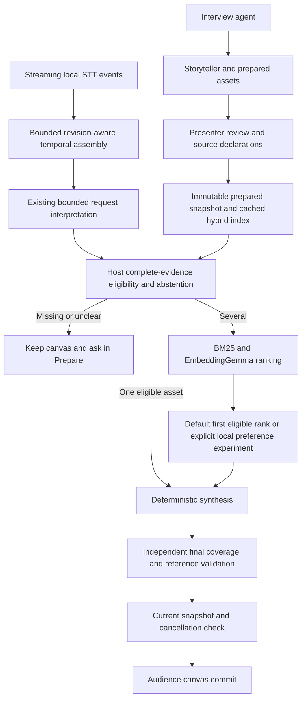
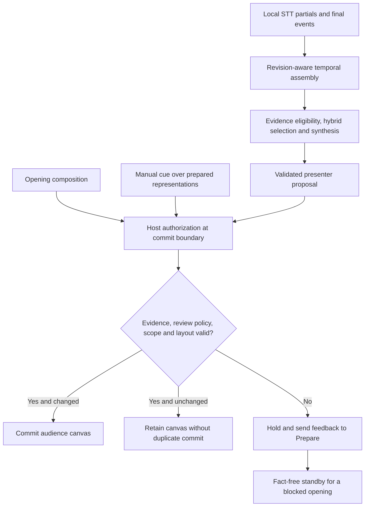
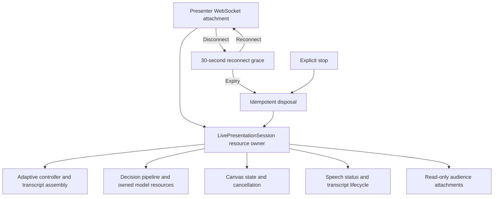

# Current architecture and defaults

20 October 2026. Native SwiftUI macOS interface with a bundled TypeScript coordinator. Model-free tests do not establish native microphone or spontaneous-speech acceptance.

## Findings adopted in code

`server/config/defaults.ts` is the coordinator's fallback policy: local Qwen preparation, local hybrid live selection and deterministic synthesis. The native Model Settings window can point preparation at any configured OpenAI-compatible endpoint. Its credentials are stored in the per-user settings file and never sent back to the UI. EmbeddingGemma 2 ONNX is pinned in `runtime/retrieval-model.json`; the coordinator loads its quantized text encoder through Transformers.js. The SwiftUI app captures microphone audio and uses Apple's Speech framework only when on-device English recognition is supported. This native speech port has not earned real-microphone acceptance merely because the prior Moonshine/WASM experiments ran.

`createPresenter()` constructs no billed decision model for normal presentation. `baseline` remains an alias for local hybrid. The old helper that implicitly selected a hosted Clef model was removed; explicit hosted comparisons resolve a named registry entry. Credential transport now accepts only `OPENROUTER_API_KEY` and does not inspect another application's auth files.

The default composition root uses the already-tested synthesis planner (up to four supported components), with a focus fallback when independent component coverage is insufficient. `OMNIPRESENT_COMPOSITION_PLANNER` still explicitly selects a comparison planner. This adoption does not turn authored synthesis fixtures into natural-speech acceptance.

Python-backed classifier profiles were removed from the product factory. Their comparisons remain in historical reports; neither is an available app selection. A separately named optional research runner remains for reproducing the archived Laya comparison; the packaged application excludes it. The normal path remains local hybrid with host eligibility and final validation.

## Data and authority

Models propose references. Host code owns evidence eligibility, abstention, lifecycle, final validation and commit. A story is a narrative prior, not a voice-controlled slide deck. Unknown facts are never approved because a candidate is semantically close. Missing evidence is routed back to preparation with the story/project identity.

Preparation, voice, retrieval and preference are separate roles. The SwiftUI application communicates with a bundled TypeScript coordinator over localhost HTTP and WebSocket. No Python environment is required by the active runtime. Projects and stories are persisted in SQLite under `~/Library/Application Support/Omnipresent`; uploads, settings and model caches are kept alongside it. Concurrent editing from multiple windows is not supported. Uploaded assets, credentials and model downloads remain outside tracked source.

Live presentation sessions own their controller and speech status independently of the presenter socket. Reconnection within 30 seconds preserves the canvas and reacquires renderer microphone capture; an expired session starts afresh with normal indexing readiness. Explicit stop disposes the session. Audience sockets are read-only and receive a rendering projection plus canvas/status events, without interview messages, source text, private notes, transcripts or traces. This role boundary is for the local app, not a multi-user authentication system. Manual cues cancel older proposals and use host evidence eligibility, including strict independent-review mode.

Story bundles include referenced image bytes under their content hashes. Import validates media before workspace mutation, with an 8 MB per-image and 24 MB total media limit. Existing bundles without embedded media require those files to already exist locally. Full preparation context remains in the bundle; audience projection is applied only when presenting.

## Unresolved language boundary

The alpha real-audio experiment failed its supported panel explanation when Moonshine split it into two final segments. A subsequent temporal-assembly experiment recovered that authored case: 4/4 recordings passed versus 3/4 for per-final processing. Adding a separate compiled story-signal index gave the same results and was removed. The existing reviewed vocabulary and evidence interpreter remain authoritative; there is no new keyword filter or additional VAD. See [assembly ablation and limits](../research/speech-assembly.md). On 32 distinct natural preference utterances, the strict parser also produced no present intents. The role-only preference screen therefore used explicitly declared intents and reports that limitation.

Do not describe this architecture as solved speech understanding. Bounded completed-speech assembly is now implemented: partials remain display-only, source intervals and line revisions preserve complete text, and a 350 ms quiet window precedes host processing. It adds roughly 350–400 ms after the final event in the small development replay. Unknown obligations are not removed. Real microphones, delayed continuations and a local intent/purpose proposal layer still require evaluation against missing evidence, negation, corrections and stale work; general speech understanding remains unresolved.

See [latest experiments](../research/preference-quality.md), [local selection lifecycle](local-selection.md), [historical baseline](baseline.md), and [roadmap](../roadmap.md). The historical baseline's hosted defaults are superseded by this document.

## Common commit authority and resumable ownership

The opening, manual cues and automatic proposals now pass `server/presentation/authorization.ts` at the controller commit boundary. It reconstructs the request from host-owned story evidence or the full utterance and reuses the complete composition validator: evidence eligibility, independent review policy, explicit requested form, component coverage, layout and final grounding. A model cannot bypass this by returning a structurally valid composition. Inferred form remains a preference; spoken constraints remain binding. A blocked opening displays a fact-free “Ready to present” standby and sends feedback to Prepare. Invalid or stale later proposals preserve the canvas. SwiftUI maps the approved semantic component kinds to native text, chart, diagram and image views; it does not execute generated code.

`server/presentation/live-session.ts` owns resumable resources and idempotent disposal: controller, canvas session, presenter, speech state, audience attachments and reconnect expiry. Its lifecycle distinguishes loaded, preparing, ready and disposed. The WebSocket connection borrows these resources; replacing it cancels expiry, while final expiry or stop releases them once. Wire messages and saved story formats are unchanged. Microphone capture lives in the native SwiftUI process; the coordinator receives transcript events and owns temporal assembly, evidence decisions and commit.

These are incremental implementations of stages 1 and 2 of the domain review. Stable component identities, narrower audience contracts and shared preparation commands remain separate work. The software audit verifies model-free authorization, cleanup, reconnect and privacy regressions; it does not establish a latency gain or general speech acceptance.

### Final authorization for every entry path

Partials remain display-only. The controller rejects cancelled or stale work before authorization. Presenter validation and the independent host commit check are separate boundaries; redundant checks within the controller were removed. Neither models nor renderer adapters can authorize evidence.

### Resumable presentation ownership

The owner tracks loaded, preparing, ready and disposed states. Socket replacement retains the existing resources and cancels expiry. Disposal cancels decisions, releases the presenter and notifies audiences. Renderer microphone capture stops when its session ends; the coordinator never owns an audio worker.

Latest cleanup software evidence: [RUN-20261019-runtime-cleanup-audit-v1](../validation/runs/RUN-20261019-runtime-cleanup-audit-v1/run.json), with 167 passing tests and a successful production build. This is distinct from the small authored audio replay and does not establish general microphone acceptance.

## Preparation harness foundation

The interview/storyteller prompts are versioned in `server/preparation/prompts.ts`. The storyteller uses the built-in evidence-backed-story procedure and shared host-validated draft operation. See [presentation harness, source map and workflow diagram](presentation-harness.md) for implemented boundaries, tests and deferred extensions. This does not change the local live decision path or confer approval/commit authority on agents.

## Native macOS application

`macos/OmnipresentApp.swift` and `macos/RootView.swift` build the product interface with SwiftUI, AppKit, AVFoundation, Speech and Swift Charts. The app bundle includes the compiled coordinator, production Node dependencies and a Node runtime. `AppModel` owns UI state and communicates with the coordinator through typed JSON HTTP/WebSocket messages. Model settings are edited in a native Settings scene; secrets stay in Application Support and are never returned by the settings API. There is no Electron, React, Vite or browser UI in the active product. Core coordinator tests remain independent of model weights; a packaging check compiles the SwiftUI app. Native UI interaction, microphone quality, Intel compatibility, signing and notarization remain to be validated. See [native macOS setup](../desktop-macos-alpha.md).
