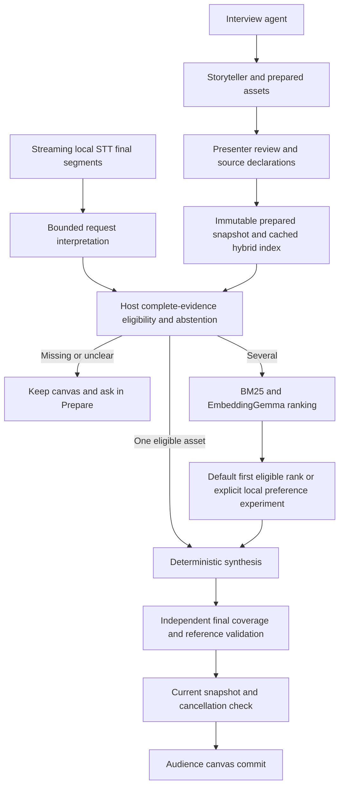

# Current architecture and defaults

19 October 2026. Implemented local development architecture; spontaneous-speech acceptance remains failed.

## Findings adopted in code

`server/config/defaults.ts` is the product composition root's default policy: local Qwen preparation, local hybrid live selection and deterministic synthesis. EmbeddingGemma is pinned in `runtime/retrieval-model.json`; Moonshine Small Streaming remains the local STT reference. These latter choices have not earned independent production acceptance merely because preference tests ran.

`createPresenter()` constructs no billed decision model for normal presentation. `baseline` remains an alias for local hybrid. The old helper that implicitly selected a hosted Clef model was removed; explicit hosted comparisons resolve a named registry entry. Credential transport now accepts only `OPENROUTER_API_KEY` and does not inspect another application's auth files.

The default composition root uses the already-tested synthesis planner (up to four supported components), with a focus fallback when independent component coverage is insufficient. `OMNIPRESENT_COMPOSITION_PLANNER` still explicitly selects a comparison planner. This adoption does not turn authored synthesis fixtures into natural-speech acceptance.

Live preference profiles are explicit: `local-classifier` loads the pinned native GLiNER reference, and `local-reranker` loads the pinned 22.7M MiniLM experiment. Both use the same eligible-menu abstraction, worker lifecycle, 300 ms deadline, local fallback and final host validation. Neither is the default: MiniLM matched hybrid accuracy; timed GLiNER fell back on every distinct-preference case; dynamic INT8 was worse. Experimental model environments and weights are not loaded in the normal presenter.

## Data and authority

Models propose references. Host code owns evidence eligibility, abstention, lifecycle, final validation and commit. A story is a narrative prior, not a voice-controlled slide deck. Unknown facts are never approved because a candidate is semantically close. Missing evidence is routed back to preparation with the story/project identity.

Preparation, voice, retrieval and preference are separate roles. The TypeScript coordinator, React canvas and isolated Python workers form a modular local application; no new service framework was introduced. Projects and stories are cached in browser storage and persisted in local SQLite. Startup hydration is guarded against concurrent edits, and tab-local writes are serialized/coalesced. Concurrent editing from multiple tabs is not supported. Uploaded artifacts live under ignored output directories, and model downloads remain outside tracked source.

Live presentation sessions own their controller and speech runtime independently of the presenter socket. Reconnection within 30 seconds preserves the canvas and reacquires microphone capture; an expired session starts afresh with normal indexing readiness. Explicit stop disposes the session. Audience sockets are read-only and receive a rendering projection plus canvas/status events, without interview messages, source text, private notes, transcripts or traces. This role boundary is for the local app, not a multi-user authentication system. Manual cues cancel older proposals and use host evidence eligibility, including strict independent-review mode.

Story bundles include referenced image bytes under their content hashes. Import validates media before workspace mutation, with an 8 MB per-image and 24 MB total media limit. Existing bundles without embedded media require those files to already exist locally. Full preparation context remains in the bundle; audience projection is applied only when presenting.

## Unresolved language boundary

The latest real audio experiment failed its supported positive explanation. Moonshine split it into two final segments and altered wording; the bounded interpreter requested context and held instead of reaching selection. On 32 distinct natural preference utterances, the strict parser also produced no present intents. The role-only preference screen therefore used explicitly declared intents and reports that limitation.

Do not describe this architecture as solved speech understanding. Next work is bounded completed-speech context and a local intent/purpose proposal layer, evaluated against missing evidence, negation, corrections and stale work before default adoption. Those improvements are a roadmap item, not a hidden new inference step in this snapshot.

See [latest experiments](../research/preference-quality.md), [local selection lifecycle](local-selection.md), [historical baseline](baseline.md), and [roadmap](../roadmap.md). The historical baseline's hosted defaults are superseded by this document.
