# Modularization for repeatable experiments

17 October 2026 · Code inspection and proposed next steps · Not implemented.

The [selected baseline](baseline.md) remains the default. Model providers already have separate interfaces. The next useful abstractions are pipeline policies and the experiment harness, rather than more provider wrappers or a new orchestration framework. Keep a modular monolith and introduce boundaries where we have competing implementations or need isolated measurement.

## Highest priority seams

| Priority | Boundary | Current coupling | Experiments enabled |
| --- | --- | --- | --- |
| 1 | Retrieval strategy | `LibraryPolicy.refresh` constructs `LibrarySearch`; query encoding, lexical/vector ranking and index construction are reached through the concrete class. | Hybrid fusion, lexical-only controls, caches, incremental indexing, scoped search and prediction-assisted prefetch under identical policy. |
| 1 | Intent and scope resolution | `BaselinePresenter` interprets aliases and appends inferred entity/provenance/form to speech; the evidence gate interprets the rewritten string again. | Rules, FSM or behavior-tree interpretation against the same explicit request obligations, without rewriting the original transcript. |
| 1 | Experiment runner and trace sink | Benchmark scripts repeat snapshotting, counters, timings, budget checks and summaries. The live presenter supplies no-op grounding trace/budget hooks. | Comparable full-path replay across profiles, including refreshes, fallback attempts, final checks and failures. |
| 2 | Candidate selection policy | `groundLibrary` combines prompt construction, response decoding, top-5/top-12 fallback, timeout and billing validation. | Different shortlist sizes, fallback rules, abstention thresholds and model request formats independently of provider choice. |
| 2 | Composition planner | `presentationCatalog` binds each asset directly to a focus composition. Selecting content therefore also selects layout. | Compatible multi-component layouts, progressive reveal, stable identity and change-cost rules independently of retrieval and selection. |
| 2 | Turn scheduler | `AdaptiveController` combines transcript coalescing, cancellation, timeout, lifecycle and commit. | Endpointing/coalescing windows, interruption and speculative work without changing evidence or rendering. |
| 3 | Preparation workflow and tools | `buildAgent` assembles roles, prompts, tools and output contracts together. | Interview strategies, storyteller variants, context builders and diagram/chart tool implementations. |
| 3 | Input and material services | Browser capture and queueing live in `App.tsx`; upload HTTP handling, extraction subprocess, storage and a process-global busy flag live in `materials.ts`. | Replay/microphone parity, alternate extraction/OCR and bounded concurrent ingestion. |
| 3 | Renderer and frontend services | `AdaptiveCanvas.tsx` contains both renderer adapters; `App.tsx` owns workspace persistence, socket lifecycle, audio and views. | OpenUI/JSON-render comparisons on the same plan, UI changes without altering capture or session state. |

Start with a whole retrieval interface, not an interface for every scoring function. Keep the existing hybrid implementation as the first implementation. Add finer scoring seams when an actual experiment needs them.

## Proposed data boundaries

```mermaid
flowchart LR
    T[Transcript event] --> I[Intent interpreter]
    I --> R[Request frame]
    R --> G[Mandatory evidence eligibility]
    G --> S[Retrieval strategy]
    S --> C[Ranked candidate set]
    C --> D[Selection policy and decision model]
    D --> P[Composition planner]
    P --> V[Mandatory final validation]
    V --> H[Host commit authority]
    H --> U[Renderer adapter]
```

These are proposed contracts, not claims of current implementation:

- **Request frame:** original transcript, resolved claim obligations, explicit versus inferred scope, interpretation uncertainty, request ID and snapshot revision. A resolver proposes context; it cannot approve evidence.
- **Candidate set:** stable component IDs, ranking signals, eligibility explanations, catalog/embedding-space identity, cache provenance and any escape to broader search.
- **Selection:** selected IDs or hold/context, reason, attempts, provider identity and revision. Do not embed a renderer-specific layout here.
- **Composition plan:** selected references, layout, reveal and emphasis, with compatibility and change-cost information. Revalidate every displayed component against all request obligations.
- **Trace:** parent request/run IDs, stage timings, refresh/cache/fallback events, errors, model usage and final outcome. Record unavailable billing as unavailable, separately from malformed semantic output. Preserve the configured spending guard.

A versioned experiment profile should assemble these modules at one composition root. It should resolve configuration once, record exact model and policy versions, and keep experimental settings out of the main product UI. The baseline profile stays explicit and reproducible. No dynamic plugin loader, microservices or new database is required.

## Concrete problems to address during extraction

1. `library-grounding.ts` currently tells the model that provenance labels and figures are simulated benchmark data. That wording is shared with the live runtime. Separate dataset-specific context from production instructions before using this prompt for further live comparisons.
2. `BaselinePresenter` ignores its `current` argument, while `LibraryPolicy`, `AdaptiveController` and `Session` each retain aspects of current content. Define one authoritative committed presentation state; strategies receive an immutable snapshot and return proposals. Commit acknowledgement must synchronize the next decision's state.
3. `presentationCatalog` assigns the current calendar year when the evidence timeframe is absent. Unknown time must remain unknown, not become a synthetic date. Its numeric year field also needs a deliberate representation for non-year periods.
4. Catalog cue generation parses beat position out of component IDs. Store source references explicitly. Separate content identity from array position, layout and revision.
5. Beat-level evidence is copied onto every component family. A chart, image and statement need component-specific claim coverage before a planner can safely combine them. Source presence and hashes alone do not prove that a component supports a claim.
6. `prepareEvidence` rebuilds draft contracts on story generation. Separate contract construction, verification and review invalidation so editing presentation wording cannot accidentally be treated as semantic evidence verification.
7. Missing provider cost currently fails grounding as a functional error. Keep response validity, usage availability and budget enforcement separate; an unknown cost must not silently bypass a spending cap.

## Invariants that experiments cannot replace

Host-owned evidence approval, source/reference integrity, complete claim coverage, revision checks, cancellation epochs and commit authority remain mandatory. Experimental interpreters, retrievers, models and planners can propose content, but cannot bypass these checks. A cache hit or prefetched choice must pass the same final validation as a fresh result. Missing evidence retains the audience canvas and produces private preparation feedback.

Use revision-aware caches keyed by content hashes, embedding-space identity and policy version. Test cold, warm, changed-source, withdrawn-evidence and cancelled-request cases. Do not report warm-cache model timing as total user-perceived latency.

## Recommended implementation order

1. Extract a retrieval interface and immutable request-frame contract while retaining the current behavior. Characterize cue, unknown evidence, explicit scope, refresh and cancellation behavior before changes. Fix the live prompt context leak in this slice.
2. Add one shared replay runner and trace sink for new experiments. Run the unchanged baseline through it first; check outcomes against frozen expected decisions and record failures. Leave historical runners, source snapshots and reports intact for reproducibility.
3. Extract selection policy and composition planning. First reproduce the current single-component output; then compare richer composition and FSM/behavior-tree proposals with the same guards and datasets.
4. Separate ingestion, speech input, preparation tools, renderer adapters and frontend services as those experiments arise. Preserve conversation drafts, saved sessions and active presentation lifecycle during UI refactors.

For every comparison, freeze profile, source and input hashes; use paired repeated/counterbalanced runs; report selection and missing-evidence quality alongside median/p95 including refreshes, fallbacks and final grounding. Report initial indexing and browser/STT/paint boundaries separately. Existing authored development results are not independent holdout or natural-speech acceptance.

This assessment changes documentation only. None of these proposed interfaces or quality improvements has been implemented or benchmarked by this review.

## Implementation checkpoint: first slice

The first slice is implemented and recorded in [RUN-20261017-retrieval-request-seams](../validation/runs/RUN-20261017-retrieval-request-seams/run.json): 83/83 automated tests pass, and TypeScript plus the production build pass. This supersedes the assessment-only status for the following items; other proposals above remain unimplemented.

- `RetrievalFactory` constructs a revision-identified `RetrievalSnapshot` with build/retrieve operations. `LibraryPolicy` accepts the factory; the default adapter wraps the existing BM25/vector/RRF implementation. Cue bypass, frozen snapshots, stale-result rejection and final reference checks remain in the host policy.
- `RequestInterpreter` returns an immutable `RequestFrame` containing original transcript, snapshot identity, resolved intent and separately recorded inferred entity/provenance/form. `BaselinePresenter` accepts this interpreter and retrieval factory. The evidence gate accepts a bounded interpreter while retaining its existing support checks.
- The story resolver preserves the previous scope-resolution behavior. Internally it still invokes the bounded alias parser on enriched text to recheck obligations and temporal requirements; this is not a new general speech understanding system. Retrieval and model grounding continue receiving the original utterance.
- Removed simulated-benchmark wording from the shared live grounding instructions. Provider response validation, fallback counts and budget behavior are unchanged.

New tests cover injected retrieval ranking and cue bypass, immutable request frames, inferred versus explicit scope, ambiguous scope, missing time, unknown obligations, quotations and live grounding instructions. Existing refresh/cancellation/evidence tests run in the full suite. No new provider calls, browser/audio tests or performance comparison were performed. Existing build chunk-size warnings remain.

Next slice: shared replay runner and trace sink, beginning with baseline parity and stage accounting before introducing new retrieval or composition policies. Live trace hooks, authoritative current-state consolidation, catalog time/identity and component-specific evidence work remain outstanding.

## Implementation checkpoint: frontend and replay infrastructure

19 October 2026: the [frontend services and renderer boundaries](frontend-modules.md) and [shared replay runner/trace sinks](replay-and-tracing.md) are implemented. Live model trace hooks are now connected to metadata events. The synthetic paired policy replay preserves all 37 authored case outcomes across three passes per arm, with scheduled refreshes; it does not benchmark real model quality or speed. Remaining priorities include selection/composition separation, authoritative committed-state consolidation, catalog time/identity and component-specific claim coverage.

## Implementation checkpoint: composition boundary

19 October 2026: [selection and composition are separate](composition-planners.md), with default focus and opt-in stable planners. Explicit catalog references replace layout bindings. A host-owned final guard validates every proposed block; cloned planner context prevents plugins rewriting its evidence. Current-asset state is synchronized from the supplied committed canvas before each decision. New multi-component synthesis remains gated on component-specific evidence coverage. Synthetic shared-runner scenarios establish behavior, not a model quality/latency ranking.

## Implementation checkpoint: explicit component coverage

19 October 2026: [component-level contracts and paired planning](component-coverage.md) are implemented. New visual/image coverage is not inherited merely from beat placement. Component/source hashes, presenter approval and final plan checks gate the optional same-beat two-component planner. Existing focus is still the default. Coverage declarations are not independent proof, and finer claim modeling remains open.

## Implementation checkpoint: bounded richer synthesis

19 October 2026: [up to four components with explicit cross-beat coverage](richer-synthesis.md), stable slots, duplicate suppression, readability budgets and renderer geometry checks are implemented behind the optional synthesis planner. The default remains focus. Authored tests preserve missing-evidence behavior; independent semantic and natural-speech acceptance remain open.

## Current optimization review

The [19 October latency/cost review](../reviews/latency-cost-architecture.md) evaluates the current implemented pipeline and supersedes older proposed coupling descriptions for optimization planning. It recommends compiled approved snapshots, one request frame, exact vector caching and explicit readiness first; selection/scheduler/renderer changes require paired quality and full-path timing comparisons. Recommendations are not implemented or measured speedups.

## Compiled presentation optimization checkpoint

The [compiled snapshot, exact vector cache and readiness slice](compiled-presentations.md) is implemented. It preserves selection/fallback defaults, reuses one request frame, caches only immutable integrity/exact vectors, and prepares the index before speech starts. Paired local-embedding replay and readiness/cancellation evidence are recorded separately from historical model or audio acceptance.

## Local selection policy boundary

[AssetSelector and the local default](local-selection.md) now separate eligibility, preference and provider transport. Experiments can substitute local ranking/classifier preferences while the host retains final evidence and commit authority. The normal factory does not construct a billed decision model.
