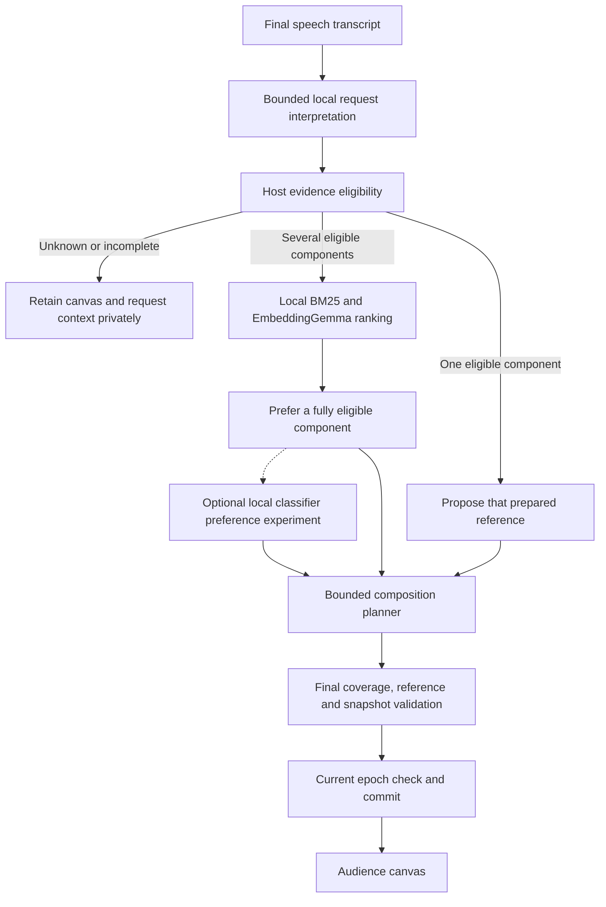
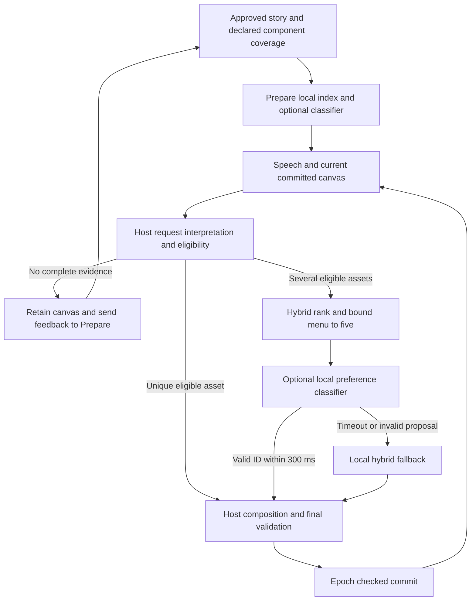

> Latest preference quality and real audio findings: [local preference quality](../research/preference-quality.md). A 22.7M reranker was tested; neither timed candidate passed promotion, and natural intent/STT segmentation remain blockers.

# Local-only live selection baseline

19 October 2026 · Implemented development default; independent natural-speech acceptance remains open.

The normal live presenter no longer requires a billed LLM or System One model. Host rules establish the current request and complete evidence eligibility. A unique eligible component can be selected directly; multiple eligible alternatives use local hybrid BM25/EmbeddingGemma ranking. The existing deterministic composition planner and final evidence/reference/epoch checks remain in place.

This assigns each component a narrower job. EmbeddingGemma ranks prepared content; it does not prove a claim or independently decide whether unknown evidence exists. A small classifier can propose a preference among eligible alternatives through the same interface, but the tested native GLiNER worker did not improve this development set and is not loaded in the default app. No local failure automatically invokes a hosted service.

## Module boundaries

- `AssetSelector` owns optional unique-eligible preselection and preference among ranked eligible candidates. `LocalHybridSelector` is the normal implementation; `RankedEligibleSelector` is the always-rank comparison. `ClassifierPreferenceSelector` accepts a `LocalPreferenceModel` and cannot return a reference outside its fully eligible menu.
- `BaselinePresenter` still constructs one request frame per turn. Its per-call selector receives original speech, immutable request obligations, committed selection, snapshot assets and independent-review policy. The evidence gate runs before selection and after every proposed show. The composition guard still validates the planner's isolated proposal independently.
- `LibraryPolicy` accepts a per-call grounder as well as a per-call gate. Existing callers keep their original injected grounder. The live presenter passes a local selector rather than constructing an unconditional provider request on initialization.
- `createPresenter()` is the application composition root. Missing profile, `baseline` and `local-hybrid` create a presenter with **no provider model object**. The old `OMNIPRESENT_DECISION_MODEL` value does not select a provider for this normal path. Historical provider-registry helpers remain available for explicit experimental code; server defaults no longer use them.
- The optional runtime `LocalClassifierPreference` starts the pinned native English GLiNER checkpoint in a separate local Python process. Weights must already be cached; the worker uses local-only loading, a bounded five-option menu and conservative token-budget rejection. It never supplies hold/context or evidence approval. Its process is closed when its selected presenter is replaced or its socket disconnects. The default profile still loads no classifier.

The replay's Experiment inspector now labels its default `Local hybrid`. A caller deliberately choosing `clef-omni`, Jev or another registered comparison model can still exercise that explicit adapter. Existing hosted artifacts are retained for comparison, but no hosted model is required for ordinary presentation. Interview/storytelling retain the existing local model configuration; this change does not silently reconfigure a deliberately supplied external preparation endpoint.



No independent semantic claim is manufactured from the nearest retrieved result. The bounded request interpreter still over-abstains on some spontaneous paraphrases, as the [previous compact screen](../research/compact_local_results.md) showed. Reassigning roles removes required provider billing; it does not establish general natural-language understanding.

## Executed role comparison

[EXP-054 raw replay](../validation/runs/RUN-20261019-local-roles-v2/replay.json) uses real local EmbeddingGemma with 432 constructed distractors plus six curated EIA/USGS cards. The original 37 expected actions and IDs were retained. Five new cases add an explicitly declared alternative, repeated preference, missing extra evidence, withdrawal and restoration. Those preference cases declare both acceptable references before model execution. The alternate inherits declared claim coverage; it is not independently verified new evidence.

Each arm runs 42 authored cases × three passes, with counterbalanced per-case order, isolated embedding caches per arm/pass, eight scheduled refreshes per pass, exact query/document vector caching and final host evidence validation. The native classifier process is resident across the comparison; its startup is recorded separately. There are no new hosted requests or teacher labels.

| Role assignment | Correct | Positive / negative | Wrong shows | Query encodes per pass | Decision median / p95 |
| --- | --- | --- | --- | --- | --- |
| Eligibility first, hybrid preference when needed | 126/126 | 72/72, 54/54 | 0 | 2 | 1.69 / 68.81 ms |
| Hybrid ranking for each unresolved cue | 126/126 | 72/72, 54/54 | 0 | 12 | 1.32 / 92.79 ms |
| Eligibility first, native GLiNER preference when ambiguous | 126/126 | 72/72, 54/54 | 0 | 2 | 1.70 / 163.43 ms |

The first arm made 21 unique-eligible preselections and three ranked selections per pass. The classifier made nine real local choices across all passes, about 1.37 seconds total compute; its process startup took about 8.45 seconds. It earned no quality gain here, so it is not part of the default profile. All arms encoded 447 documents per pass including initial indexing and changed-document refreshes. Query reduction is about 83%; full indexing was not eliminated.

These percentiles include applicable refreshes, query encoding, local preference, final evidence checks and failures. Initial index construction and classifier startup are separate in the report. p95 improved when ranking was skipped for unique eligibility; median did not consistently improve, so this is not a blanket speedup claim. Frame interpretation happens before the policy but inside the replay turn timer. No prior hosted timing is causally compared with these local measurements.

The shared runner now retains actual selected IDs while accepting a frozen declared set of equivalent outcomes. After the model run, the acceptable-set array was additionally frozen and regression-tested; the archived run used the earlier source snapshot and did not mutate expectations. Initial run v1 failed before input freeze/model execution due to a case-sensitive fixture lookup; its bootstrap failure is retained.

This is a 42-case development replay with repeated observations, not 126 independent cases or a large real-media holdout. It does not execute STT, audience paint, the full preparation-to-live workflow or concurrency stress. Complete composition/source-withdrawal/cancellation tests remain separately covered by the software suite. Local compute, RAM and energy remain costs even though provider billing is zero.

## Running-system verification

[Actual local WebSocket integration](../validation/runs/RUN-20261019-local-roles-live/local.json) confirms that omitting the profile loads `local-hybrid`, a non-exact explanatory utterance produces four supported components, and installation-cost speech retains the canvas with a context outcome. The observed cue-to-decision interval was about 32 ms; zero provider-attempt trace events occurred. This is a local text-event integration check with real embeddings, not a microphone/audio/paint latency measurement. The coordinator was restarted with the existing synthesis demo setting and the new factory default.

Software tests cover complete obligations, independent-review requirements, invalid preference IDs, cancelled requests, injected provider non-use, local default even under a provider environment setting, unchanged synthesis and missing evidence, plus acceptable-set scoring. [Software audit](../validation/runs/RUN-20261019-local-roles-final-audit/run.json): 129 tests and build pass.

## Reproduce and next experiments

```sh
# Local embedding runtime and previously installed/cached classifier reference are needed for all three arms:
node --import tsx scripts/local-role-replay.ts RUN-your-unique-id
# With the coordinator running (synthesis demo configured):
node --import tsx scripts/local-only-live-probe.ts output/unique-local-probe
npm test
npm run build
```

The default app does not need the classifier reference to present. Keep new intent-proposal experiments separate from evidence approval: unknown obligations must not disappear merely because a nearby asset ranks highly. Next useful comparisons are calibrated local paraphrase-to-request proposals, lexical/vector scoring alternatives, current-content preference/change cost, and indexing/readiness under resource contention. Use independently reviewed natural speech before claiming unchanged broad presentation quality. Quantizing the optional classifier is unnecessary for the selected default because the default does not load it.


## Runtime preference boundary — 19 October follow-up

The implemented `local-classifier` profile now connects the native pinned GLiNER worker to the real presentation coordinator. The host still controls intent, full evidence eligibility, abstention, composition validation and commit. The classifier only chooses an asset ID from at most five already eligible, hybrid-ranked references. One eligible reference bypasses inference. Missing evidence never reaches the classifier as an approval question.

Preparation waits for the local worker and hybrid index before `presentation_ready`. A preference call has a 300 ms budget: timeout, malformed output, oversized token menu, unavailable worker or out-of-menu ID falls back to the first eligible hybrid-ranked asset. Parent cancellation propagates instead of committing a fallback. Cancelled native jobs continue computing, but remain in the eight-job queue accounting until they drain; there is no unbounded cancellation queue. No failure calls a hosted model. Model load failure is a visible readiness error, rather than claiming the classifier is ready.

The selector records successful choices and fallbacks in decision metadata. Its process lives for the selected presenter, is reused across turns, and closes on replacement/disconnection. `server/models/local-preference.ts` owns the worker protocol; the old experiment import reexports this shared implementation so replay and runtime exercise the same code. The native model remains a roughly 1.95 GB FP32 reference, not a validated compact or quantized shipping model.



[Live loop evidence](../validation/runs/RUN-20261019-local-preference-loop-v1/local.json) records four-component synthesis, missing-evidence retention and feedback addressed to the correct project/story, with no provider-attempt events. The native preference exceeded its deadline in that run: **zero successful classifier choices and one local fallback**; total decision interval was about 343 ms. Thus it validates the bounded fallback and feedback path, not a successful native preference or an interview/audio/browser end-to-end run. Existing local preparation and browser feedback handling are reused. Repairing evidence still requires review and saving an updated story; the live controller does not manufacture evidence or silently approve a revision.

Architecture decision: keep `local-hybrid` as the normal default and make `local-classifier` an explicit runtime experiment. Existing and repeated quality comparisons do not establish a classifier advantage. The abstraction supports a genuinely smaller local model later without changing host authority. Do not promote a model based only on selecting any of several equivalent assets: the next promotion gate needs distinct preferred-form expectations and independently reviewed spontaneous speech, alongside startup/RAM and fallback-inclusive p95.

Reproduce the actual coordinator loop with the local embedding service and cached classifier installed:

```sh
OMNIPRESENT_COMPOSITION_PLANNER=synthesis npm run dev
node --import tsx scripts/local-preference-live-probe.ts output/unique-preference-loop
```

The profile can be supplied as `decision: "local-classifier"` on `presentation_load`; no normal presentation UI controls were added. Provider experiments remain explicit.


Follow-up evidence: the [shared-runtime repeat](../validation/runs/RUN-20261019-local-preference-runtime-v1/replay.json) again produced 126/126 correct decisions per arm, zero unsupported shows, and 24 refreshes per arm. Eligibility-first hybrid median/p95 was **1.73/68.51 ms**, always-ranked hybrid **1.57/92.30 ms**, classifier preference **1.71/171.42 ms**. Nine native choices used about 1.36 seconds compute; worker startup was 6.59 seconds, separately recorded. Initial index preparation was about 11–12 seconds per arm/pass. These are repeated authored cases with equivalent alternative IDs, not evidence that the classifier improves asset preference. A separate warm coordinator probe overlapped near the end, so timing is not an isolated causal comparison; the conclusion remains consistent with the prior non-overlapped run.

The [warm coordinator follow-up](../validation/runs/RUN-20261019-local-preference-loop-v2/local.json) confirms a genuine native preference succeeded: cumulative metadata reports one successful choice and one fallback. The first call fell back (353 ms total), the next committed using native preference (240 ms total), and another utterance retained the canvas (0.40 ms). Missing evidence still routed feedback and retained content. These observations include shared-machine replay contention and do not include speech recognition or browser paint. Both cold and warm evidence, including the fallback, are preserved rather than reporting only the successful call. Software audit: 132 tests and production build pass.
