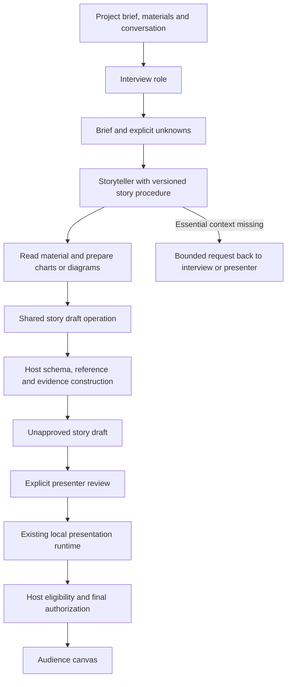

# Omnipresent as a presentation harness

20 October 2026. Incremental implemented foundation, not a replacement agent framework.

The harness coordinates preparation context, specialized roles, tools and host rules to produce a reviewable story and a speech-responsive canvas. Preparation can use flexible agent workflows; live presentation remains a bounded local decision pipeline. Agents propose; host code authorizes and commits.

## Responsibilities and source map

| Harness component | Existing implementation and this increment | Boundary |
| --- | --- | --- |
| System prompts | `server/preparation/prompts.ts`: extracted interview, storyteller and shared policy, with an explicit version | Prompts guide; code enforces authority. |
| Memory | `Preparation` brief/materials/messages/events; workspace SQLite and browser cache; immutable prepared snapshots; ephemeral live sessions | Project context, reviewed story and live state have different lifetimes. No new universal memory store. |
| Tools | `buildAgent` exposes role-specific tools for material reading, research, chart/diagram generation and draft updates | Tool schemas and domain validation constrain model proposals. |
| Skills | `server/preparation/story-skill.ts`: built-in `evidence-backed-story` v1.0.0, procedural instructions plus shared draft operation | Product workflow, not an editor SKILL.md, dynamic script or plugin loader. |
| Guardrails | Reference validation, evidence construction, explicit presenter review, live eligibility, cancellation and final authorization | A skill cannot self-approve evidence or publish to the audience. |
| Scripts | Existing setup, replay, benchmark and software-audit runners | Experiments do not execute implicitly in normal product operation. |
| Specialized agents | Existing interview and storyteller roles with bounded context requests; local presentation decision pipeline | These are coordinated roles, not newly spawned autonomous agents. |
| Plugins | Existing model/selector/planner/renderer interfaces | Extension seams exist; general plugin discovery/loading remains deferred. |

## First built-in skill: evidence-backed story

The storyteller always receives the built-in procedure: understand audience/outcome, inspect relevant materials, organize the narrative, prepare useful visuals, check coverage, and propose a draft or request essential missing context. It does not prescribe a fixed slide template. Optional visuals must not block a useful conceptual explanation.

`proposeFlow` now delegates to the skill's `propose` operation in `server/preparation/story-draft.ts`. This shared operation parses the draft, strips model-supplied host evidence fields, validates references, constructs unapproved evidence contracts, invalidates prior approval and records a bounded handoff event. Validation occurs before state mutation. The existing controller works on a cloned draft and rejects cancelled/stale turns before publishing preparation state.

The procedure is prompt guidance, not a deterministic proof that the model read every relevant source or built a good narrative. Tool schemas, reference validation and host approval are executable constraints. Search excerpts remain untrusted source material, and numeric presence checks alone do not establish factual correctness.

## Validation and limits

`tests/preparation-harness.test.ts` drives the real SDK tool loop with a scripted model through material reading, chart creation, returned-reference reuse, draft proposal and explicit review. Additional checks cover cancellation, invalid references without partial mutation, and reconstruction of supplied evidence fields. Existing interview handoff, missing-context, stale-turn and live guardrail tests remain active.

This establishes integration and domain safety, not improved narrative quality, live model compliance, microphone acceptance or latency. No hosted inference or model download is required. Evidence: `RUN-20261020-preparation-harness-audit-v1`.

## Next bounded extensions

Evaluate the procedure with authored briefs/materials and explicit story-quality rubrics before claiming improvement. Extract chart/diagram and brief operations when another caller needs them. Add a second skill only for a concrete use case with a distinct evaluation. A dynamic skill registry, plugin loader, extra live sub-agent and new memory infrastructure are deliberately outside this increment. No persisted schema, wire contract or live model default changes.
