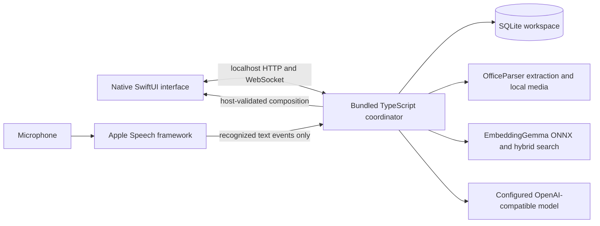

# Native macOS app

Omnipresent's supported product UI is a SwiftUI app for macOS 14+. It embeds the TypeScript coordinator and runtime dependencies in its app bundle. There is no Electron shell, React renderer, browser product or hosted web-app mode.

## Build and launch

```sh
npm ci
npm run setup:env
ollama pull qwen3.5:4b
npm run dev
```

The development command type-checks the coordinator, builds `output/macos/Omnipresent.app` and launches the native executable with the current environment. A standalone build is:

```sh
npm run build
npm run macos:pack
open output/macos/Omnipresent.app
```

The package includes a standalone Node 22.22.1 Apple Silicon runtime downloaded from nodejs.org and verified against its pinned SHA-256, production npm dependencies and the SwiftUI binary. Browser-only ONNX/WASM binaries are removed; the native macOS ONNX runtime is retained. Builds use ad-hoc signing for local testing; public distribution needs Developer ID signing and notarization.

## Model settings and local data

Use **Omnipresent → Settings…** to set an OpenAI-compatible endpoint, model name and optional API key. The coordinator stores these at `~/Library/Application Support/Omnipresent/settings.json` with owner-only file permissions; the UI receives only whether a key exists. A connection test calls the configured endpoint's model-list route. A remote endpoint receives preparation conversation content when used.

SQLite workspace data, uploaded image assets and Hugging Face cache are also stored under `~/Library/Application Support/Omnipresent`. `.env` is for development overrides and remains local. Do not put keys in tracked files. See [configuration](configuration.md).

## Runtime boundaries



Speech recognition requests on-device English support. If macOS cannot provide that mode, voice presentation stops with a clear error. Audio buffers are not sent to the TypeScript coordinator; recognized transcript updates are. The coordinator remains the authority for evidence eligibility, abstention, final validation, cancellation and canvas commit. See [current architecture](architecture/current.md).
