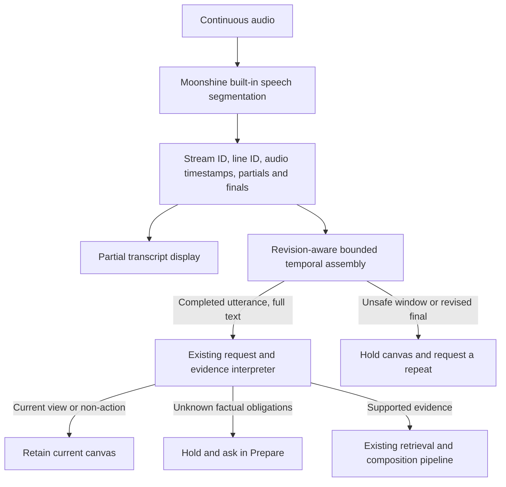

# Transcript assembly and the signal-gate ablation

19 October 2026 development work. This is a bounded integration result, not independent spontaneous-speech acceptance.

## Decision

Keep a small temporal transcript assembler. Remove the extra compiled story-signal repository and its Aho–Corasick matcher from runtime. Do not add a second VAD or a keyword filter.

The story already contains reviewed claim aliases and cue metadata. The existing evidence interpreter uses this vocabulary and owns retain/missing-evidence decisions. A second matching index needs a measured scheduling or search benefit before it earns a place in the architecture. No match must never mean that a factual request is discarded.

## Comparison

All arms received identical actual Moonshine events from the same paced Piper audio. Four authored recordings covered a split panel explanation, a battery explanation, an unsupported installation-cost request and “Keep this visual.” No hosted model was called.

| Development run | Per-final processing | Temporal assembly | Assembly plus separate signal index |
| --- | --- | --- | --- |
| v1 | 3/4 | 3/4 | 3/4 |
| v2, overlapping-interval fix | 3/4 | 4/4 | 4/4 |
| v3, signal index removed | 3/4 | 4/4 | Removed |

v1 incorrectly rejected the roughly 224 ms overlap between Moonshine's two panel segments. That failure is retained. v2 merges overlapping source-audio intervals rather than treating the overlap as corruption. Temporal assembly and signal-assisted assembly produced the same decisions and host-call counts. The signal index therefore demonstrated no incremental benefit in these cases and was removed, along with the additional storyteller instruction to generate detection metadata. Its tested implementation remains in immutable source snapshots only.

v3 starts the panel case on the battery beat: assembled speech must actually switch to the panel content, while the old per-final path holds the battery view. Battery, missing-cost and retain results stay correct. Final-to-direction time is approximately 350–400 ms for assembly versus under a few milliseconds after each final on the old path. This is an explicit endpointing-delay tradeoff to recover meaning, not a latency win. One run per recording is insufficient for stable p95 estimates or broad quality claims.

Reports: [v1](../validation/runs/RUN-20261019-transcript-ablation-v1/local.json), [v2](../validation/runs/RUN-20261019-transcript-ablation-v2/local.json), [minimal v3](../validation/runs/RUN-20261019-transcript-minimal-v3/local.json). Each retains inputs, model identity, event timestamps, decisions and source hashes. Inputs are authored development examples reused after diagnosis; they are not a holdout.

## Implemented flow

The assembler does not decide what is true, rewrite recognition mistakes or remove words to make an alias match. It updates partials by stable line ID, deduplicates repeated finals, merges overlapping/adjacent finalized intervals and separates confirmed larger silence gaps. New speech invalidates older in-flight decisions. Stop, pause, manual cue and presenter replacement clear pending assembly; ending the presentation disposes its timer. Worker stop can deliver final transcription; explicit presentation stop prevents further commits.

Parameters are injected as `TranscriptPolicy`: 350 ms quiet delay, 1,250 ms inter-interval join gap, 15 s maximum open window, 6,000 characters and eight segments. The controller polls at 50 ms. These are development defaults, not universal language constants. Exceeding a bound or receiving an amended final abstains and asks for pause/resume plus a complete repeat; it never keeps only the suffix. Unknown speech still reaches the host. Only empty/duplicate transport events and interim revisions avoid decision processing.

## VAD assessment

The installed `moonshine-voice==0.1.5` exposes line-start, partial-update and line-completion events with audio timing; its transcript API describes VAD lines. The worker now forwards those existing signals. [Moonshine's upstream C API](https://github.com/moonshine-ai/moonshine/blob/main/core/moonshine-c-api.h) also describes VAD-based lines and stable references. This existing segmentation should be measured before stacking another detector.

[Silero's streaming VAD](https://github.com/snakers4/silero-vad/blob/master/src/silero_vad/utils_vad.py) offers configurable speech probabilities, silence thresholds and padding. It is a reasonable future alternative to compare for noise, silence cost and endpoint accuracy. It was not installed or benchmarked here. An acoustic boundary detector cannot by itself recover the meaning of two correctly recognized fragments.

## Remaining validation

Automated regressions cover partial replacement, duplicates, overlapping intervals, actual silence gaps, retired streams, pause/manual cancellation, unknown requests, negation, hypothetical requests, mixed current-view/missing-evidence statements and budget overflow. One hundred seeded interval configurations assert that every finalized word is preserved in order across overlaps and gaps.

Next: real microphones, noisy/long speech, varied speakers, cross-language behavior, delayed continuation beyond the quiet window and representative current-view explanations. The minimal assembler does not retrospectively rejoin an utterance already dispatched before a delayed continuation; this is a disclosed tradeoff after removing the extra prefix gate. Any later relevance gate or local classifier should be assessed by false negatives and missing-evidence preservation, total latency including fallbacks, and incremental benefit over the existing interpreter.
