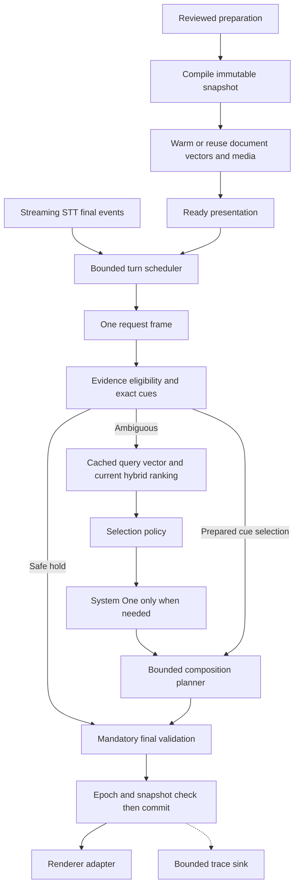

# Architecture review: less work per spoken turn

19 October 2026 · Current-source inspection and archived execution evidence. Recommendations only; runtime unchanged by this review.

## Decision

Keep the modular TypeScript/Python application and evidence-first pipeline. The next optimization should be **compile once, reuse safely, and invoke selection models only when necessary**. Additional agent frameworks, services, or model wrappers would add complexity without addressing the observed work.

We cannot yet promise unchanged natural-speech quality: the source-backed library remains pending independent review, and the successful spoken demonstration required presenter corrections and tuned narration. Separate behavior-preserving engineering from policy changes. Preserve the current default focus planner; synthesis is opt-in.

## Current path and evidence

`BaselinePresenter.decide` serializes flow, visuals and all artifacts on every turn. On first use or change it builds a catalog and awaits `LibraryPolicy.refresh`, which eagerly builds the hybrid embedding index before any eligibility/cue decision. `LibrarySearch.build` embeds all documents in batches of 24; changed revisions and a new presenter instance rebuild them. The active `LibrarySearch.query` has no query cache. The older `SemanticIndex.cachedQueries` is not used by this path. The Python embedding runner has one inference lock and no persistent vector cache.

`evidenceGate.before`, `after` on shows, and composition setup independently interpret the same utterance. `storyRequestFrame` can parse it again with resolved scope. Parsing repeatedly calls schema/source-hash validation across assets. Synthesis validates tentative additions, then its returned result, then the presenter validates it again; the controller also validates composition shape. These checks have distinct trust roles but repeat immutable integrity work.

The live demo's archived generation-first decision times were 225.8 ms on first use and 0.20–2.34 ms thereafter; storage-first was 181.9 ms initially and 0.26–1.98 ms thereafter. All 13 decisions used cue/guard paths, with **zero hosted selection calls**. These are tiny tuned demonstrations, not latency distributions or STT-to-paint measurements. They demonstrate first-turn overhead, not its precise stage attribution. Files: `output/full-demo/generation-first-replay.json` and `storage-first-replay.json`; durable copies are in [the frozen full-demo run](../validation/runs/RUN-20261019-full-spoken-demo/demo.json).

The older [EXP-037](../research/evidence_gate_results.md) authored development set reduced grounding calls from 27 to 4 per pass and improved decision median/p95 while preserving its 37 labeled outcomes. It supports avoiding unnecessary model calls, not eliminating ambiguous selection. The three-pass run recorded $0.03611505 for 93 total hosted calls across arms; this is historical measured usage, not a current price quotation. No dollar saving can be inferred for the latest demo because its selection-call cost was already zero. Local model compute, memory and energy still cost resources.

## Recommended changes

| Order | Change | Work removed / likely benefit | Quality boundary |
| --- | --- | --- | --- |
| 1 | Compile an immutable `PreparedPresentation` on load/reviewed revision | Repeated whole-state serialization, catalog scans, alias preparation, reference lookups and immutable source hashing | Validate all content/contracts at compilation. Final commit still checks request coverage, approval, snapshot identity and epoch. |
| 1 | Add a scoped bounded `EmbeddingCache` behind `Embedder` | Duplicate document embeddings across reloads/revisions; repeated query encoding | Exact input and full embedding-space/preprocessing identity keys, query/document separation, bounded memory, cancellation-safe writes. Preserve existing hybrid ranking. |
| 1 | Separate `prepare()` from `decide()` and expose readiness | Cold index work moves before presentation; memoized ready snapshots are reusable | Report readiness and cold/amortized session cost. Moving work earlier is not eliminating it. No stale approved snapshot reuse. |
| 1 | Produce one immutable request frame per turn | Repeated alias parsing and scope resolution | Same interpreter, same explicit/inferred distinction; pass this frame through preflight, selection and final checks. |
| 2 | Split `SelectionPolicy` from `DecisionModel` | Exposes menu, fallback and budget experiments independently of provider classes | Start with identical top-5 → top-12 behavior and exact response checks; demonstrate parity before changing it. |
| 2 | Compile component metadata and eligibility once per request | Repeated source/content hashing and array scans inside synthesis proposals | Cache only immutable integrity results; request-dependent coverage and final untrusted proposal validation remain mandatory. |
| 2 | Add a bounded `TurnScheduler` | Isolates transcript coalescing, stale-work cancellation and deadlines | First preserve current FIFO/coalescing behavior; interruption and temporal context are separate quality experiments. |
| 2 | Lazy-load renderer adapters and prewarm used media | Avoid downloading both experimental rendering stacks initially; reduce first-chart/diagram stalls | Keep OpenUI/json-render comparison available. Confirm keyboard, layout, image and chart parity. |
| 3 | Sample/export detailed tracing outside playback's hot path | Avoid per-stage WebSocket serialization and repeated JSON formatting in the trial UI | Always retain outcome/errors, call/cost accounting and bounded diagnostic capture. Hidden inspector alone does not stop telemetry work. |

### Snapshot and cache design

A snapshot contains scoped identity, content/contract digest, prevalidated evidence records, alias/claim lookup, `assetById`, `referenceById`, reverse `(beat,kind)` lookup, component content identities and compatible-scope metadata. It must be host-owned and deeply immutable. `Object.freeze(new Map())` does not prevent `set`; use private maps/read-only accessors or copied views. Do not expose mutable shared cache state to experimental planners. Preserve proposal isolation or return a compact immutable planner view instead of cloning all raw materials each turn.

The preparation revision alone is insufficient as a cache key: it must be tied to the actual approved snapshot and content hashes, not trusted from incoming browser state. Revalidate at load/edit boundaries. Any source withdrawal, changed content, approval change, policy version or embedding-space change invalidates relevant results. Tenant/project scope is explicit; start with per-session/process caches to avoid accidental cross-project sharing.

Document vectors depend on canonical text, model revision, dimensions, normalization and prompt/preprocessing version. Query vectors also depend on query mode/prefix. Cache vectors rather than final decisions first. A repeated query may reuse its vector while final selection is recomputed for current obligations, catalog, review policy and committed canvas. Use bounded eviction and request deduplication; one caller cancelling must not abort another caller's valid shared request. Failed/cancelled results cannot become ready cache entries.

Incremental embeddings do not mean incrementally preserving old BM25 scores: additions/removals alter document frequency and mean document length. Rebuild lexical corpus statistics and recompute RRF over the current snapshot while reusing unchanged document vectors.

Lazy embedding construction is an alternate retrieval experiment: exact cues and guarded holds need no vector index, so startup could avoid it altogether and build on first ambiguous query. Compare it against prewarming; lazy creation improves cue-only resource use but may worsen ambiguous p95. Concurrent document prewarming must not block query encoding behind the Python runner's global lock. Initially favor explicit readiness plus cached vectors, then compare lazy and priority scheduling under contention.

### Selection experiments, after parity

The mandatory gate currently asks whether *any* asset is eligible, but retrieval/grounding still sees unfiltered assets. A request-scoped eligible menu can reduce irrelevant choices and fallback cost. Keep full catalog context for intent interpretation and missing-evidence detection. Change the retrieval contract to accept an eligibility mask only when comparing this policy; removing items before RRF can alter rankings and is not automatically equivalent. Do not broaden scope to make an empty menu nonempty.

If exactly one eligible prepared component remains, deterministic selection is a useful experiment. It is not a license to choose the top semantic hit or collapse genuinely ambiguous layouts. Verify explicit form, quotes, corrections, missing obligations and retention behavior. More than one acceptable component may still require a ranking/selection policy.

`groundLibrary` retries top-12 for every context answer, including genuine missing evidence. Compare fallback only when the broader menu adds eligible candidates; reuse the same result if menus are identical. Also test one-call versus two-call menus with complete cost and quality accounting. Do not remove the fallback merely to improve median. Provider usage availability and budget enforcement should be separate from semantic decoding; unknown cost cannot bypass a spending cap.

A whole-decision cache is later work: it needs request-frame, snapshot, current canvas, planner, model/policy version and review setting in its key, plus final validation. Semantic similarity alone is an unsafe key for decisions involving negation, dates, units, audit requests or additional claims.

### Speech scheduling and concurrency

`AdaptiveController.accept` queues appended transcript fragments while a request is running; it does not interrupt that request on each new fragment. `LibraryPolicy` has cancellation protection, but the controller normally invokes it serially. A slow hosted request can delay subsequent speech by its remaining latency; the current 20-second grounding timeout and two-attempt path can approach the controller's 30-second deadline.

Do not equate latest-wins with dropping all earlier fragments: it can discard the subject or a correction. Introduce a scheduler contract with bounded context, explicit supersession, turn IDs and an end-to-end deadline. Compare coalescing windows, cancellation, hysteresis/minimum dwell and newest-complete-intent behavior on actual fragmented STT. Use partial transcripts only for speculative retrieval/prewarming; commit on validated finalized intent until a separate policy is accepted.

One STT worker is spawned per WebSocket. There is no demonstrated concurrency capacity result. Reuse warm resources within a session where safe; a worker pool is justified only after measuring memory/queue pressure. A shared mutable recognizer can mix speakers and must not be substituted casually. More threads or async endpoints do not make the embedding model itself concurrent; measure queue time separately from compute.

## What can be removed or kept outside the live dependency graph

- Forecast-first/reversed-routing, FSM/behavior-tree comparison helpers and older semantic index are experiment code, not evidence of extra stages running in the default path. Moving them into an experiment namespace improves maintenance, not live latency. Preserve scripts, source snapshots and negative findings. Check all script/test imports before deleting anything.
- The live UI already receives a validated `AdaptiveComposition`. OpenUI currently parses a host-generated program to render two registered components; json-render builds an equivalent tree. A direct React renderer is a credible third control and could remove that serialization/parser layer from the production bundle. Compare paint time, bundle size, stable identity and visual parity before selecting it. This is client work, not a hosted-token saving, and does not require abandoning generative composition.
- Interview and storyteller should remain separate roles. Share preparation execution/tool infrastructure, but retain role contracts. Fix structured asset/reference binding and validation-assisted correction before adding another agent; the full demo's omitted IDs show a preparation reliability gap that caching cannot fix.
- Keep System One available for ambiguity, local hybrid retrieval, streaming STT, host evidence gates, revision/cancellation boundaries, and independent final validation of untrusted proposals. Do not replace hybrid search with semantic-only search, weaken complete-claim checks, or add a general live LLM.
- Keep TypeScript orchestration and isolated Python inference. Rust/Go, LiveKit, a vector database, microservices and a new orchestration framework are not required by these findings.

## Target architecture

A cue is a selection proposal: composition planning and mandatory validation still apply. Cache hits never commit independently.

## Validation and implementation sequence

1. Freeze current behavior and profiles. Add compiled snapshot, one-frame evaluation, exact-vector cache and readiness independently, using existing seams. No provider/model or selection-policy change in this slice.
2. Run paired/counterbalanced replay with separate caches and identical frozen inputs: cold, warm, repeated queries, edits, changed approval, source withdrawal, model-space changes, failures, timeouts, cancellations and concurrent sessions. Record cache hits/misses, encoded document/query counts, calls, usage availability, queue/compute time, planning/validation and refresh costs.
3. Require exact action/selected IDs for behavior-preserving changes and identical composition content/slot behavior. Keep all negative constraints and zero new unsupported shows. For policy changes use reviewed acceptable sets, not only baseline agreement; shared baseline failures are still failures. Stratify missing evidence, quotations, corrections, units/time, unrelated speech and positive selection so extra abstention cannot masquerade as quality.
4. Measure transcript-final→validated-commit median/p95, audio-onset→visible-paint separately, startup and amortized session totals, memory, hosted calls/cost and wasted speculative work. Include failures, fallback, refresh and final validation. Small deterministic cue times do not predict speech latency.
5. Only then compare eligible-menu selection, fallback policies, scheduler supersession, lazy indexing and direct React rendering. Promote each independently if gains repeat across passes and preserved quality. Use the existing replay runner/trace interfaces; extend them for concurrency and browser paint rather than inventing another benchmark stack.

No new speedup, dollar reduction or production-quality equivalence was measured in this review. Highest-confidence first implementation: **compiled approved snapshot + one request frame + exact document/query embedding cache + explicit readiness**. The broad natural-speech/independent evidence gate remains open.

## Implementation follow-up

The [first compiled/cache/readiness slice](../architecture/compiled-presentations.md) is now implemented and measured separately. This review remains the original recommendation record; its runtime-unchanged statement describes the review turn. Later shortlist, scheduler and renderer experiments remain proposals.
